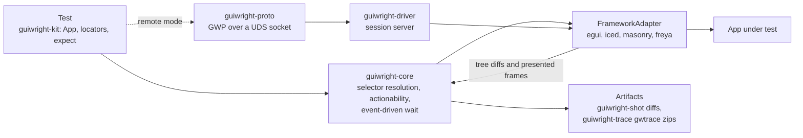

<div align="center">
  
  <p>
    <strong>Playwright-grade GUI testing for Rust frameworks, driven through the AccessKit accessibility tree.</strong><br/>
    Locators resolve against each framework's accessibility tree, actions run through its real
    input pipeline, and every step auto-waits on tree diffs and frame boundaries instead of
    sleeping. Adapters for egui, Masonry/Xilem, iced and Freya run in-process for tests, and the
    same adapter contract is served over a Unix domain socket for out-of-process sessions. The
    framework-agnostic core depends only on AccessKit, and the whole workspace forbids unsafe code.
  </p>
  <p>
    <a href="https://github.com/elcoosp/guiwright/actions/workflows/ci.yml"></a>
    <a href="https://github.com/elcoosp/guiwright/blob/main/.github/workflows/ci.yml"></a>
    <a href="https://github.com/elcoosp/guiwright/blob/main/Cargo.toml"></a>
    <a href="https://github.com/elcoosp/guiwright/blob/main/Cargo.toml"></a>
    <a href="LICENSE-MIT"></a>
    <a href="https://github.com/elcoosp/guiwright/blob/main/Cargo.toml"></a>
  </p>
</div>

<p align="center">
  <a href="#quickstart">Quickstart</a> • <a href="#features">Features</a> • <a href="#how-it-works">How it works</a> • <a href="#usage">Usage</a> • <a href="#status">Status</a> • <a href="#learn-more">Learn more</a>
</p>

## Quickstart

Requires Rust 1.85 or newer (edition 2024). Tests run headless in your process; no display server or window is needed.

Add the kit to your dev dependencies:

```toml
[dev-dependencies]
guiwright-kit = { git = "https://github.com/elcoosp/guiwright" }
accesskit = "0.25"
```

Write a test. The `#[guiwright_kit::test]` macro launches the built-in fixture app (a "Save" button, a "Welcome, Ada" label and an "Email" text input), so this runs as-is:

```rust
use accesskit::Role;
use guiwright_kit::{App, expect};

#[guiwright_kit::test]
fn login_flow(app: &mut App) -> Result<(), String> {
    // Auto-waits for actionability, then clicks through the adapter.
    app.get_by_role(Role::Button, "Save")
        .click()
        .map_err(|e| e.to_string())?;

    // Retries until the condition holds or the 5 s default timeout expires.
    expect(app.get_by_text("Welcome, Ada"))
        .to_be_visible()
        .map_err(|e| e.to_string())?;
    Ok(())
}
```

Run it like any other Rust test:

```bash
cargo test
```

Swap in a real framework adapter with `App::launch(name, adapter)` as shown in [Usage](#usage).

> [!TIP]
> Set `GW_TRACE=1` to record a `gwtrace/v1` zip archive (tree snapshots, input events, logs, frame captures) per test, and `GUIWRIGHT_BLESS=1` to accept failing screenshot baselines.

## Features

- **Playwright-shaped locators.** `get_by_role`, `get_by_label`, `get_by_text`, `get_by_test_id` and `get_by_value`, with `.first()` / `.nth()` / `.has_text(...)` filters and strict-mode failure on ambiguous matches (`crates/guiwright-core/src/selector.rs`).
- **Actionability auto-wait without polling.** Clicks and fills wait for attached / visible / stable / enabled / receives-events checks that are woken by tree diffs and presented frames; a waiter fed no events does no work (`crates/guiwright-core/src/actionability.rs`, `crates/guiwright-core/src/wait.rs`, pinned by `crates/guiwright-core/tests/auto_wait.rs`).
- **Retry-until-timeout assertions.** `expect(locator).to_be_visible()`, `to_have_text`, `to_have_value` and friends complete exactly when the condition turns true, or fail with the last tree summary embedded in the error (`crates/guiwright-core/src/expect.rs`).
- **Screenshot baselines with a perceptual diff.** Weighted squared YIQ pixel distance, an absolute `max_failed_pixels` budget, per-OS baseline directories and a `GUIWRIGHT_BLESS` flow that leaves `.new.png` and `.diff.png` artifacts next to a failing baseline (`crates/guiwright-shot`).
- **Time-travel traces.** Opt-in `gwtrace/v1` zip archives with postcard+LZ4 tree snapshots, hash-deduped frame captures and a `tracing`-fed event log, recorded through a bounded lock-free ring to a writer thread (`crates/guiwright-trace`).
- **Embedded and remote through one trait.** Tests call the `FrameworkAdapter` directly in-process; the same contract is served over the GWP wire protocol (length-prefixed postcard framing, LZ4 blob side channel) on a Unix domain socket and over TCP for CI containers (`crates/guiwright-driver`, `crates/guiwright-proto`).
- **Live REPL over the wire.** `guiwright repl` attaches to a running remote-mode app — locators, actions, the virtual clock, state seams, codegen recording and video, all as commands mapped 1:1 onto GWP requests (`crates/guiwright-cli`, architecture §13/§16).
- **Trace viewer + CLI plumbing.** `guiwright show-trace` renders a `gwtrace/v1` zip into a self-contained scrubber HTML, `guiwright bless` promotes CI screenshot artifacts onto their baselines, `guiwright install-deps` prints the §11 CI provisioning commands (`crates/guiwright-viewer`, `crates/guiwright-cli`).
- **Performance budgets enforced in CI.** Criterion benches plus a `check_budgets` binary that fails the build when p95 samples regress against `bench/budgets.toml` (`crates/guiwright-bench`, `.github/workflows/ci.yml`).

## How it works

Every framework implements one `FrameworkAdapter` trait whose methods execute on the UI thread at frame boundaries. Frameworks that already emit an AccessKit tree (egui, Masonry, Freya) hand their `TreeUpdate`s to the adapter, which folds them into an incremental consumer tree; for iced, which has no accessibility tree, the adapter builds one from widget reports plus a role registry contributed by the app. Selectors resolve against that tree, semantic actions rendezvous with the next frame, and waiters are woken by diffs and frame-presented events rather than by polling. In remote mode, the driver exposes the same adapter contract as a session server speaking GWP over a Unix domain socket, so out-of-process clients get identical semantics.



## Usage

The examples below are condensed from the workspace's own integration tests.

### Click and assert against a real app (egui)

```rust
use std::{cell::RefCell, rc::Rc, time::{Duration, Instant}};

use accesskit::Role;
use guiwright_adapter_egui::EguiAdapter;
use guiwright_core::Selector;
use guiwright_driver::Session;

let state = Rc::new(RefCell::new(CounterApp::default()));
let ui_state = Rc::clone(&state);
let adapter = EguiAdapter::new(move |ctx: &egui::Context| {
    ui_state.borrow_mut().ui(ctx); // your normal egui painting code
});

let mut session = Session::new(adapter);
session.settle(Instant::now() + Duration::from_secs(2));
session.click(&Selector::role_named(Role::Button, "Save"))?;
assert_eq!(state.borrow().clicks, 1);
```

The adapter drives a real `egui::Context` windowless: AccessKit tree generation, synthetic input and a virtual clock all run through the standard `Session` loop, so embedded and remote sessions behave identically (see `crates/guiwright-adapter-egui/tests/egui_embedded.rs`).

### Screenshots and baselines

```rust
use guiwright_kit::{App, BlessMode};

let mut app = App::launch("shot_test", my_adapter)
    .with_baseline_dir("tests/screenshots");

app.screenshot("main", BlessMode::Failing)?; // first run: writes the baseline
app.screenshot("main", BlessMode::Off)?;     // later runs: Matched or Mismatch
```

A mismatch fails the test and writes `<name>.new.png` plus a rendered `<name>.diff.png` next to the baseline. Baselines are stored per platform, scale factor and renderer; tolerances come from `Guiwright.toml` with per-OS overrides. A virtual clock (`app.clock_fast_forward(Duration::from_secs(30))`) makes time-dependent UI deterministic.

### Remote session over a Unix domain socket

```rust
use guiwright_driver::{MockAdapter, spawn_session_server};
use guiwright_proto::{Client, RequestV1, ResponseV1};

// App side (or a test host): serve GWP on a UDS socket. Real apps serve
// their own adapter; MockAdapter comes from guiwright-driver's `mock` feature.
let handle = spawn_session_server(socket_path, || MockAdapter::with_fixture(&fixture))?;

// Client side: handshake, then Playwright-shaped commands over the wire.
let mut client = Client::connect(&socket_path).await?;
let caps = client.handshake("guiwright-tests/0.1").await?;
match client.request(RequestV1::TreeSnapshot).await? {
    ResponseV1::TreeSnapshot { node_count, .. } => println!("{node_count} nodes"),
    other => panic!("unexpected response: {other:?}"),
}
```

Resolve requests carry selectors and auto-wait over the wire the same way embedded sessions do (see `crates/guiwright-driver/tests/remote_session.rs`).

### Live REPL against a running app (M4)

```bash
# App side: serve its adapter in remote mode (§5.3).
GUIWRIGHT_DRIVER=uds:///tmp/app.gwp ./my-app &

# Your side: attach and debug interactively.
guiwright repl --uds /tmp/app.gwp
```

```text
gw> snapshot
tree @3: 12 nodes
gw> get role Button Save
resolved Button "Save" (generation 0) rect=[16,16 → 136,48]
gw> click
Button "Save": clicked (frame 7)
gw> clock install
clock: virtual=0ms paused=false steps=0
gw> codegen start
…act, then…
gw> codegen stop
codegen: 1 line(s), 0 warning(s)
app.get_by_role(Role::Button, "Save").click();
```

Every command maps onto a GWP request — the same conversation works over TCP (`guiwright repl --tcp 127.0.0.1:41234`) and from the TypeScript client (`clients/typescript`). `guiwright show-trace <archive.zip>` renders a recorded trace into a self-contained HTML scrubber, `guiwright bless <dir>` promotes CI screenshot artifacts onto their baselines, and `guiwright install-deps` prints the §11 CI provisioning commands (see `crates/guiwright-cli/tests/`).

### Supported adapters

| Framework | Crate | Accessibility source | CI coverage |
|---|---|---|---|
| egui | `guiwright-adapter-egui` | egui's own AccessKit tree (Level 1) | embedded tests on Linux, macOS, Windows |
| Masonry / Xilem | `guiwright-adapter-masonry` | `RenderRoot` via `masonry_testing::TestHarness` (Level 1) | embedded tests on Linux, macOS, Windows |
| iced | `guiwright-adapter-iced` | Guiwright-built logical tree + app-contributed role registry (Level 2); harness glue behind the `iced` feature | compile-verified in CI |
| Freya | `guiwright-adapter-freya` | `freya_testing` harness + `a11y_id` bridge (Level 1); runner glue behind the `freya` feature | compile-verified in CI |

"Level" is the integration tier from [docs/architecture.md](docs/architecture.md): Level 1 piggybacks on a framework's existing accessibility tree, Level 2 synthesizes one.

## Status

> [!NOTE]
> Guiwright is a pre-release project at version 0.1.0, with milestones M0–M2 of the plan in [docs/architecture.md](docs/architecture.md) implemented across the workspace crates, M3 shipped as framework-free adapter engines (floem, gpui), the video recorder and the TypeScript client, and M4 — the `guiwright-cli` crate (`repl`, `show-trace`, `bless`, `install-deps`) plus remote codegen recording (§13) — covered by in-repo integration tests. CI exercises the full test suite on Linux, macOS and Windows (Linux uses software Vulkan via lavapipe for render-dependent tests), runs the TypeScript client suite and the cross-language e2e, compile-verifies the feature-gated iced and freya harness glue, and enforces the perf budgets. The floem and gpui platform glue ships downstream (recorded constraints in the crate docs and `docs/m3-floem-contributions.md`). Crates are packaged by the release workflow into GitHub releases; crates.io publication is not yet automated. The MSRV is 1.85 and the workspace forbids unsafe code.

## Learn more

- [docs/architecture.md](docs/architecture.md) — the full design: per-framework integration dossiers, process model, the GWP protocol spec, the Playwright parity map and performance engineering.
- [CHANGELOG.md](CHANGELOG.md) — generated from Conventional Commits by git-cliff (`cliff.toml`); tagging `vX.Y.Z` triggers the release workflow.
- [bench/budgets.toml](bench/budgets.toml) — the p50/p95 budget table enforced by the CI guard.
