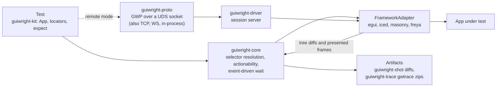

<div align="center">
  
  <p>
    <strong>Playwright-grade GUI testing for Rust frameworks — driven through the AccessKit accessibility tree.</strong><br/>
    Locators resolve against each framework's real accessibility tree, actions run through its real
    input pipeline, and every step auto-waits on tree diffs and frame boundaries — never sleeps.
    Adapters for egui, Masonry/Xilem, iced and Freya run in-process; the same adapter contract is
    served over Unix sockets, TCP, WebSocket or an in-process door for out-of-process sessions.
  </p>
  <p>
    <a href="https://github.com/elcoosp/guiwright/actions/workflows/ci.yml"></a>
    <a href="https://github.com/elcoosp/guiwright/blob/main/.github/workflows/ci.yml"></a>
    <a href="https://github.com/elcoosp/guiwright/blob/main/Cargo.toml"></a>
    <a href="https://github.com/elcoosp/guiwright/blob/main/Cargo.toml"></a>
    <a href="LICENSE-MIT"></a>
    <a href="https://github.com/elcoosp/guiwright/blob/main/Cargo.toml"></a>
  </p>
</div>

<p align="center">
  <a href="#highlights">Highlights</a> • <a href="#quickstart">Quickstart</a> • <a href="#how-it-works">How it works</a> • <a href="#the-playwright-surface">Playwright surface</a> • <a href="#remote--repl">Remote</a> • <a href="#adapters">Adapters</a> • <a href="#status--milestones">Status</a> • <a href="#learn-more">Learn more</a>
</p>

---

## Highlights

|                                         |                                                                                                                                                                                                          |
| --------------------------------------- | -------------------------------------------------------------------------------------------------------------------------------------------------------------------------------------------------------- |
| 🎭 **Playwright-shaped API**            | `get_by_*` locators with strict mode, actionability-gated actions, `expect(...)` retry-until-timeout assertions, `.not()`, `wait_for`, `all()`, count reads — [the parity map](#the-playwright-surface). |
| ⏱️ **Event-driven auto-wait**           | Attached / visible / stable / enabled / receives-events checks, woken by tree diffs and presented frames. **A waiter fed no events does no work** — no polling, no sleeps.                               |
| 🌳 **Real trees, real input**           | Selectors resolve against the framework's AccessKit tree; clicks and keys go through its actual input pipeline at frame boundaries.                                                                      |
| 🔌 **One contract, four doors**         | The same `FrameworkAdapter` runs in-process for tests and over GWP on UDS / TCP / WebSocket / an in-process duplex — identical semantics everywhere.                                                     |
| 📸 **Perceptual screenshot baselines**  | Window and element shots, weighted YIQ pixel diff, per-OS baselines, a bless flow with `.new.png` / `.diff.png` artifacts.                                                                               |
| ⏪ **Time-travel traces + live viewer** | `gwtrace/v1` zip archives render into a self-contained scrubber HTML — or attach the same scrubber to a _running_ session over any door.                                                                 |
| 🦀 **Safe and lean**                    | `unsafe` forbidden workspace-wide; the framework-agnostic core depends only on `accesskit` + `accesskit_consumer`, `thiserror` and `tracing`.                                                            |
| 📏 **Budgets as CI gates**              | Criterion benches + a `check_budgets` guard fail the build on p95 regressions against `bench/budgets.toml`.                                                                                              |

> [!IMPORTANT]
> **One semantics, every surface.** Embedded and remote sessions run the same adapter contract;
> REPL commands map 1:1 onto GWP requests and paste into CI specs verbatim; the kit, the REPL,
> the TypeScript client and the Rust client carry the same vocabulary. Every wire domain is
> append-only and byte-pinned by golden vectors — older clients keep their exact encodings.
> Timeouts are honest: they name the locator, the stuck check, and what the last evaluation found.

## Quickstart

Rust **1.85+** (edition 2024). Tests run headless in your process — no display server, no window.

```toml
[dev-dependencies]
guiwright-kit = { git = "https://github.com/elcoosp/guiwright" }
accesskit = "0.25"
```

The `#[guiwright_kit::test]` macro launches the built-in fixture app (a "Save" button, a
"Welcome, Ada" label, an "Email" input), so this runs as-is:

```rust
use accesskit::Role;
use guiwright_kit::{App, expect};

#[guiwright_kit::test]
fn login_flow(app: &mut App) -> Result<(), String> {
    // Auto-waits for actionability, then clicks through the adapter.
    app.get_by_role(Role::Button, "Save")
        .click()
        .map_err(|e| e.to_string())?;

    // Retries until the condition holds or the 5 s default timeout expires.
    expect(app.get_by_text("Welcome, Ada"))
        .to_be_visible()
        .map_err(|e| e.to_string())?;
    Ok(())
}
```

```bash
cargo test
```

Swap in a real framework with `App::launch(name, adapter)` — see [Driving a real app](#driving-a-real-app-egui).

> [!TIP]
> `GW_TRACE=1` records a `gwtrace/v1` zip per test (tree snapshots, input events, logs, frame
> captures); `GUIWRIGHT_BLESS=1` accepts failing screenshot baselines.

## How it works

Every framework implements one `FrameworkAdapter` trait whose methods execute on the UI thread
at frame boundaries. Frameworks that already emit AccessKit trees (egui, Masonry, Freya) hand
their `TreeUpdate`s to the adapter, which folds them into an incremental consumer tree; for
iced, the adapter builds one from widget reports plus an app-contributed role registry.
Selectors resolve against that tree, actions rendezvous with the next frame, and waiters wake
on diffs and frame-presented events. In remote mode the driver serves the same contract as a
GWP session server — length-prefixed postcard framing, LZ4 blob side channel.



| Crate                 | Role                                                                                                        |
| --------------------- | ----------------------------------------------------------------------------------------------------------- |
| `guiwright-kit`       | the test surface: `App`, locators, `expect`, the test macro, window handles, the virtual clock              |
| `guiwright-core`      | selector resolution, actionability, the event-driven wait engine — `accesskit`, `thiserror`, `tracing` only |
| `guiwright-driver`    | the session loop + GWP server: gestures, events, log tail, overlay routing                                  |
| `guiwright-proto`     | GWP types and framing; UDS/TCP/WS/duplex clients; the `Transport` bring-up seam                             |
| `guiwright-adapter-*` | egui · masonry · iced · freya · slint · floem · gpui ([tiers below](#adapters))                             |
| `guiwright-shot`      | perceptual diff, element crops, baseline management                                                         |
| `guiwright-trace`     | `gwtrace/v1` recorder: bounded lock-free ring → writer thread                                               |
| `guiwright-viewer`    | the scrubber HTML renderer; `LiveFeed` / `LiveTimeline` for running sessions                                |
| `guiwright-inspect`   | the overlay plan: hover outlines + interactive-role badges                                                  |
| `guiwright-cli`       | `repl` · `test` · `show-trace` · `bless` · `install-deps`                                                   |
| `guiwright-bench`     | Criterion benches + the `check_budgets` CI guard                                                            |

Plus `clients/typescript` — the TypeScript client with the same vocabulary.

## The Playwright surface

| Playwright                                                                    | Guiwright                                                                            | Notes                                                                                                   |
| ----------------------------------------------------------------------------- | ------------------------------------------------------------------------------------ | ------------------------------------------------------------------------------------------------------- |
| `getByRole` / `getByLabel` / `getByText` / `getByTestId`                      | `get_by_role` / `get_by_label` / `get_by_text` / `get_by_test_id` (+ `get_by_value`) | strict mode on ambiguity; `.first()` / `.nth()` / `.last()` / `.has_text(…)`                            |
| `click` / `fill` / `hover` / `press` / `check` / `uncheck` / `focus` / `blur` | same names (+ `set_checked`)                                                         | actionability-gated, codegen-recorded (M19)                                                             |
| `expect().toBeVisible` / `toHaveText` / `toHaveValue`                         | `to_be_visible` / `to_have_text` / `to_have_value`                                   | complete exactly when the condition turns true                                                          |
| `expect().toBeChecked`                                                        | `to_be_checked` / `to_be_unchecked` / **`to_be_checked_mixed`**                      | AccessKit's tri-state; mixed is a Guiwright extension (M20)                                             |
| `expect().toHaveCount` / `count()`                                            | `to_have_count(n)` / `count()`                                                       | the strict-mode escape hatch — waitable in both directions, `count()` a snapshot read (M22)             |
| —                                                                             | `to_have_count_greater_than` / `to_have_count_less_than`                             | one-sided count comparators, compose with `.not()` (M25 extension)                                      |
| `expect().not()`                                                              | `.not().to_*()`                                                                      | one `NotWaiter` decorator inverts the whole vocabulary; strict-mode violations still fail (M24)         |
| `locator.waitFor(state)`                                                      | `wait_for(state)`                                                                    | `attached` / `visible` / `hidden` / `stable` (M21)                                                      |
| `locator.all()`                                                               | `all(\|item\| …)`                                                                    | document order, each match an nth-pinned locator handed to the visitor — the borrow-and-act shape (M26) |
| `page.screenshot` / `locator.screenshot`                                      | `app.screenshot` / `locator.screenshot`                                              | one render pass, element crops cut by resolved bounds — never re-render                                 |
| `mouse` / `keyboard`                                                          | GWP `Gesture` domain; TS `mouse` / `keyboard`                                        | click / drag / wheel / key / type, driver-synthesized from the adapter's pacing table (M7)              |

**Auto-wait, not polling.** Actions gate on attached / visible / stable / enabled /
receives-events; the wire `Action` honors `force` (skips exactly stability + hit-test) and
`timeout_ms`, re-checking the pinned node at act time (M17). Window-scoped everything:
`app.window(handle)` aims locators, assertions, waits and input at one window's subtree.

**Failures name names.** Every timeout embeds the locator, the check vocabulary and the last
evaluation — and negations say what _still holds_ (M27's `held_on` seam):

```text
count 99 — getByRole(Button) (found 4)
not (visible — …) (still visible)
stuck on visible (node has no bounds yet)
```

### Driving a real app (egui)

```rust
use std::{cell::RefCell, rc::Rc, time::{Duration, Instant}};

use accesskit::Role;
use guiwright_adapter_egui::EguiAdapter;
use guiwright_core::Selector;
use guiwright_driver::Session;

let state = Rc::new(RefCell::new(CounterApp::default()));
let ui_state = Rc::clone(&state);
let adapter = EguiAdapter::new(move |ctx: &egui::Context| {
    ui_state.borrow_mut().ui(ctx); // your normal egui painting code
});

let mut session = Session::new(adapter);
session.settle(Instant::now() + Duration::from_secs(2));
session.click(&Selector::role_named(Role::Button, "Save"))?;
assert_eq!(state.borrow().clicks, 1);
```

The adapter drives a real `egui::Context` windowless — AccessKit generation, synthetic input and
a virtual clock through the standard `Session` loop, so embedded and remote behave identically.

## Screenshots, traces & the viewer

```rust
use guiwright_kit::{App, BlessMode};

let mut app = App::launch("shot_test", my_adapter)
    .with_baseline_dir("tests/screenshots");

app.screenshot("main", BlessMode::Failing)?; // first run: writes the baseline
app.screenshot("main", BlessMode::Off)?;     // later runs: Matched or Mismatch
```

- **Baselines**: weighted squared YIQ pixel distance, an absolute `max_failed_pixels` budget,
  per-platform / scale-factor / renderer directories, tolerances from `Guiwright.toml` with
  per-OS overrides. A mismatch writes `<name>.new.png` + `<name>.diff.png`; `GUIWRIGHT_BLESS=1`
  or `guiwright bless <dir>` promotes them. Element shots resolve → render once → crop (M9).
- **Traces**: opt-in `gwtrace/v1` zips — postcard+LZ4 tree snapshots, hash-deduped frame
  captures, a `tracing`-fed event log, recorded through a bounded lock-free ring.
- **Viewer**: `guiwright show-trace <zip>` renders a self-contained scrubber HTML; **live mode**
  (M18) attaches the same scrubber to a running session over any door and can emit the HTML
  mid-session (`render_live_html`, stamped `gwtrace/v1 (live)`, M23).
- **Inspector overlay**: `app.inspect().highlight(&locator)` composites hover outlines +
  role badges onto the app's scene at present time — adapter-level by design (egui composites
  in-pass; masonry converts to layer draw ops).
- **Deterministic time**: `app.clock_fast_forward(Duration::from_secs(30))` — the virtual clock
  makes time-dependent UI reproducible.

## Remote & REPL

One session stack, four doors — plus a seam for your own:

| Door                        | Bring-up                             | For                                                                            |
| --------------------------- | ------------------------------------ | ------------------------------------------------------------------------------ |
| **Unix socket** (default)   | `spawn_session_server` · `--uds`     | same-host apps                                                                 |
| **TCP**                     | `--tcp`                              | CI containers                                                                  |
| **WebSocket** (M15)         | `spawn_ws` · `--ws`                  | the viewer's live mode, browser clients — RFC 6455, zero new dependencies      |
| **In-process duplex** (M16) | `spawn_inprocess`                    | the whole remote stack with no socket, no filesystem                           |
| **Custom**                  | `Transport` + `spawn_transport_with` | a TLS listener or named-pipe bridge plugs in without a byte of protocol change |

All four delegate to one shared, byte-pinned connection state machine.

```bash
# App side: serve its adapter in remote mode.
GUIWRIGHT_DRIVER=uds:///tmp/app.gwp ./my-app &

# Your side: attach and debug interactively.
guiwright repl --uds /tmp/app.gwp
```

```text
gw> snapshot
tree @3: 12 nodes
gw> get role Button Save
resolved Button "Save" (generation 0) rect=[16,16 → 136,48]
gw> click
Button "Save": clicked (frame 7)
gw> clock install
clock: virtual=0ms paused=false steps=0
gw> codegen start
…act, then…
gw> codegen stop
codegen: 1 line(s), 0 warning(s)
app.get_by_role(Role::Button, "Save").click();
```

Every command is a GWP request — the same conversation works over TCP, WebSocket, and from the
TypeScript client. Beyond the demo above: `snapshot full` / `snapshot under <get-args…>` (typed
tree dumps, whole or subtree), `screenshot [path]` (window or element PNG evidence),
`mouse` / `key` / `text` (the gesture surface), `inspect on | off | clear | <get-args…>`,
`events on | off` (pushed tree diffs, frames and an opt-in `tracing` log tail — seq numbers
expose any gap a slow consumer misses), and video.

<details><summary><b>Remote client in Rust</b></summary>

```rust
use guiwright_driver::{MockAdapter, spawn_session_server};
use guiwright_proto::{Client, RequestV1, ResponseV1};

// App side (or a test host): serve GWP on a UDS socket. Real apps serve
// their own adapter; MockAdapter comes from guiwright-driver's `mock` feature.
let handle = spawn_session_server(socket_path, || MockAdapter::with_fixture(&fixture))?;

// Client side: handshake, then Playwright-shaped commands over the wire.
let mut client = Client::connect(&socket_path).await?;
let caps = client.handshake("guiwright-tests/0.1").await?;
match client.request(RequestV1::TreeSnapshot).await? {
    ResponseV1::TreeSnapshot { node_count, .. } => println!("{node_count} nodes"),
    other => panic!("unexpected response: {other:?}"),
}
```

Resolve requests carry selectors and auto-wait over the wire exactly as embedded sessions do
(`crates/guiwright-driver/tests/remote_session.rs`). The typed `ClientConn` seam mirrors every
domain: `window_list()` / `window_use()`, `subscribe` / `next_event`, screenshots, gestures.

</details>

### Multi-window

One target per window, one shared driver session; each connection aims at its own target and
locators see only that window's subtree:

```text
gw> window list
window targets (2):
  a6000000-0000-0000-0000-000000000001 Editor focused
  a6000000-0000-0000-0000-000000000002 Preview
gw> window use a6000000-0000-0000-0000-000000000001
now targeting a6000000-0000-0000-0000-000000000001 (Editor)
gw> get role button Save          # strict mode inside the editor window only
resolved Button "Save" (generation 0) rect=[16,16 → 136,48]
```

`window use` works verbatim in spec steps; the kit mirrors it (`app.windows()` /
`app.window(handle).get_by_role(…)`), as do the TypeScript (`windowList()` / `windowUse()`) and
Rust clients. Window handles are the AccessKit subtree `TreeId`s the adapter already pushes;
single-window adapters report one `main` target and need no changes.

### Scenario specs in CI — `guiwright test`

A REPL session pastes into a spec verbatim: `gwtest/v1` files declare scenarios whose steps are
REPL-command strings, driven over GWP with workers, retries, sharding and reports.

```toml
# tests/guiwright/login.spec.toml
target = "uds:///tmp/app.gwp"   # or override with --uds / --tcp / --ws

[[scenario]]
name = "save the document"
steps = [
  "get role button Save",
  "click",
  "expect role label \"Welcome, Ada\"",
]
```

```bash
# Local: run everything against a live app.
guiwright test --uds /tmp/app.gwp

# CI: one app per shard, retries for flaky scenarios, JUnit + HTML reports.
guiwright test --tcp 127.0.0.1:41234 --shard 1/3 --retries 2 \
    --report junit --report html --out guiwright-report
```

No protocol change — every step maps onto an existing GWP request. Failed scenarios re-run per
`retries` (spec, scenario or flag); passing on a retry reports `flaky`. `--list` prints
shard-aware discovery without touching the wire. Reports: `report.json` (`gwrun/v1`),
`junit.xml` (one suite per spec), a self-contained `report.html`.

## Adapters

| Framework            | Crate                                          | Accessibility source                                                                                | CI coverage                             |
| -------------------- | ---------------------------------------------- | --------------------------------------------------------------------------------------------------- | --------------------------------------- |
| egui                 | `guiwright-adapter-egui`                       | egui's own AccessKit tree (Level 1)                                                                 | embedded tests on Linux, macOS, Windows |
| Masonry / Xilem      | `guiwright-adapter-masonry`                    | `RenderRoot` via `masonry_testing::TestHarness` (Level 1)                                           | embedded tests on Linux, macOS, Windows |
| iced                 | `guiwright-adapter-iced`                       | Guiwright-built logical tree + app role registry (Level 2); glue behind the `iced` feature          | compile-verified in CI                  |
| Freya                | `guiwright-adapter-freya`                      | `freya_testing` harness + `a11y_id` bridge (Level 1); glue behind the `freya` feature               | compile-verified in CI                  |
| Slint / Floem / GPUI | `guiwright-adapter-slint` / `-floem` / `-gpui` | framework-free adapter engines (Level 1/2 hybrids — see crate docs); platform glue ships downstream | engine tests in the normal CI matrix    |

**Level 1** piggybacks on a framework's existing accessibility tree; **Level 2** synthesizes one
([docs/architecture.md](docs/architecture.md)).

## Status & milestones

> [!NOTE]
> **Pre-release at 0.4.0.** MSRV **1.85**, edition 2024, `unsafe` forbidden workspace-wide.
> Crates are packaged into GitHub releases by the release workflow; crates.io publication is
> not yet automated. The floem/gpui platform glue ships downstream (constraints recorded in the
> crate docs and `docs/m3-floem-contributions.md`).

**CI on every push:** the full test suite on Linux, macOS and Windows (Linux renders through
software Vulkan / lavapipe) · the TypeScript client suite + cross-language e2e · compile
verification of the feature-gated iced and freya glue · the perf-budget guard.

The milestone stream ([architecture doc](docs/architecture.md), records in `docs/m*.md`):

| Milestone     | Delivered                                                                                                                                                                       |
| ------------- | ------------------------------------------------------------------------------------------------------------------------------------------------------------------------------- |
| **M0–M2**     | The core: selectors, event-driven waits, the adapter trait, GWP v1, embedded sessions, the gpui remote spike                                                                    |
| **M3**        | Framework-free floem/gpui engines, the video recorder, the TypeScript client                                                                                                    |
| **M4**        | The CLI: `repl`, `show-trace`, `bless`, `install-deps` + remote codegen recording                                                                                               |
| **M5**        | `guiwright test`: `gwtest/v1` specs, workers, retries + flaky detection, sharding, JSON/JUnit/HTML reports                                                                      |
| **M6**        | Multi-window: the append-only `Window` domain, per-connection targets, kit + TS + Rust parity                                                                                   |
| **M7**        | Input over the wire: the `Gesture` domain, per-window routing, `mouse`/`key`/`text`, TS `mouse`/`keyboard`                                                                      |
| **M8**        | The inspect overlay: `EnableOverlay`/`Highlight`, the adapter `show_overlay` seam, typed errors end-to-end                                                                      |
| **M9–M10**    | Element screenshots on the kit + the wire `Screenshot` domain — one render, crops cut data-side                                                                                 |
| **M11 / M13** | Full and filtered tree dumps as typed rows — REPL, TS, byte-pinned goldens, budget rows                                                                                         |
| **M12 / M14** | The event channel: `subscribe`/`nextEvent` with gap-exposing seq numbers + the opt-in `tracing` log tail                                                                        |
| **M15–M16**   | The WebSocket and in-process duplex doors; the `Transport` seam for custom listeners                                                                                            |
| **M17**       | Wire `Action` honors `force`/`timeout_ms` — the act-time gate with named stuck checks                                                                                           |
| **M18 / M23** | The viewer's live mode over any door + mid-session scrubber HTML (`gwtrace/v1 (live)`)                                                                                          |
| **M19–M27**   | The kit parity stream: `press`/`check`/`focus`/`blur` · tri-state assertions · `wait_for` · `count` + comparators · `.not()` · `all()` · the `held_on` satisfied-state accessor |

Every wire addition is append-only and byte-pinned; every kit addition rides the same
zero-polling session loop with a named budget row — no milestone re-opened the protocol.

## Learn more

- [docs/architecture.md](docs/architecture.md) — the full design: per-framework integration dossiers, the process model, the GWP protocol spec, the Playwright parity map, performance engineering. Milestone records live alongside: `docs/m2-gpui-remote-spike.md` … `docs/m27-waiter-held-on.md`.
- [docs/m5-test-runner.md](docs/m5-test-runner.md) · [docs/m6-multi-window.md](docs/m6-multi-window.md) — the runner and window-model deep dives
- [CHANGELOG.md](CHANGELOG.md) — generated from Conventional Commits by git-cliff; tagging `vX.Y.Z` triggers the release workflow
- [bench/budgets.toml](bench/budgets.toml) — the p50/p95 budget table enforced by the CI guard

---

<div align="center">
  <sub>Licensed under MIT OR Apache-2.0 · Real trees, real input, real frames · No sleeps, no polling, no <code>unsafe</code></sub>
</div>
