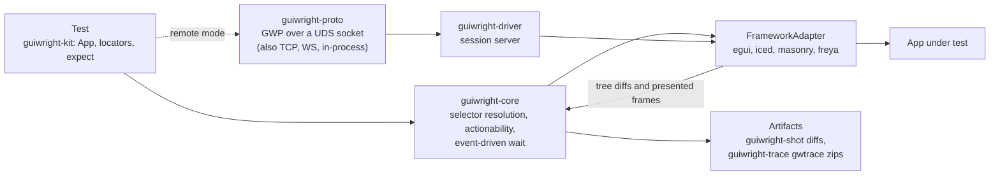

<div align="center">
  
  <p>
    <strong>Playwright-grade GUI testing for Rust frameworks — driven through the AccessKit accessibility tree.</strong><br/>
    Locators resolve against each framework's real accessibility tree, actions run through its real
    input pipeline, and every step auto-waits on tree diffs and frame boundaries — never sleeps.
    Adapters for egui, Masonry/Xilem, iced and Freya run in-process; the same adapter contract is
    served over Unix sockets, TCP, WebSocket or an in-process door for out-of-process sessions.
  </p>
  <p>
    <a href="https://github.com/elcoosp/guiwright/actions/workflows/ci.yml"></a>
    <a href="https://github.com/elcoosp/guiwright/blob/main/.github/workflows/ci.yml"></a>
    <a href="https://github.com/elcoosp/guiwright/blob/main/Cargo.toml"></a>
    <a href="https://github.com/elcoosp/guiwright/blob/main/Cargo.toml"></a>
    <a href="LICENSE-MIT"></a>
    <a href="https://github.com/elcoosp/guiwright/blob/main/Cargo.toml"></a>
  </p>
</div>

<p align="center">
  <a href="#highlights">Highlights</a> • <a href="#quickstart">Quickstart</a> • <a href="#how-it-works">How it works</a> • <a href="#the-playwright-surface">Playwright surface</a> • <a href="#remote--repl">Remote</a> • <a href="#adapters">Adapters</a> • <a href="#status--milestones">Status</a> • <a href="#learn-more">Learn more</a>
</p>

---

## Highlights

|                                         |                                                                                                                                                                                                          |
| --------------------------------------- | -------------------------------------------------------------------------------------------------------------------------------------------------------------------------------------------------------- |
| 🎭 **Playwright-shaped API**            | `get_by_*` locators with strict mode, actionability-gated actions, `expect(...)` retry-until-timeout assertions, `.not()`, `wait_for`, `all()`, count reads,
editable/readonly assertions, bulk text reads — [the parity map](#the-playwright-surface). |
| ⏱️ **Event-driven auto-wait**           | Attached / visible / stable / enabled / receives-events checks, woken by tree diffs and presented frames. **A waiter fed no events does no work** — no polling, no sleeps.                               |
| 🌳 **Real trees, real input**           | Selectors resolve against the framework's AccessKit tree; clicks and keys go through its actual input pipeline at frame boundaries.                                                                      |
| 🔌 **One contract, four doors**         | The same `FrameworkAdapter` runs in-process for tests and over GWP on UDS / TCP / WebSocket / an in-process duplex — identical semantics everywhere.                                                     |
| 📸 **Perceptual screenshot baselines**  | Window and element shots, weighted YIQ pixel diff, per-OS baselines, a bless flow with `.new.png` / `.diff.png` artifacts.                                                                               |
| ⏪ **Time-travel traces + live viewer** | `gwtrace/v1` zip archives render into a self-contained scrubber HTML — or attach the same scrubber to a _running_ session over any door.                                                                 |
| 🦀 **Safe and lean**                    | `unsafe` forbidden workspace-wide; the framework-agnostic core depends only on `accesskit` + `accesskit_consumer`, `thiserror` and `tracing`.                                                            |
| 📏 **Budgets as CI gates**              | Criterion benches + a `check_budgets` guard fail the build on p95 regressions against `bench/budgets.toml`.                                                                                              |

> [!IMPORTANT]
> **One semantics, every surface.** Embedded and remote sessions run the same adapter contract;
> REPL commands map 1:1 onto GWP requests and paste into CI specs verbatim; the kit, the REPL,
> the TypeScript client and the Rust client carry the same vocabulary. Every wire domain is
> append-only and byte-pinned by golden vectors — older clients keep their exact encodings.
> Timeouts are honest: they name the locator, the stuck check, and what the last evaluation found.

## Quickstart

Rust **1.85+** (edition 2024). Tests run headless in your process — no display server, no window.

```toml
[dev-dependencies]
guiwright-kit = { git = "https://github.com/elcoosp/guiwright" }
accesskit = "0.25"
```

The `#[guiwright_kit::test]` macro launches the built-in fixture app (a "Save" button, a
"Welcome, Ada" label, an "Email" input), so this runs as-is:

```rust
use accesskit::Role;
use guiwright_kit::{App, expect};

#[guiwright_kit::test]
fn login_flow(app: &mut App) -> Result<(), String> {
    // Auto-waits for actionability, then clicks through the adapter.
    app.get_by_role(Role::Button, "Save")
        .click()
        .map_err(|e| e.to_string())?;

    // Retries until the condition holds or the 5 s default timeout expires.
    expect(app.get_by_text("Welcome, Ada"))
        .to_be_visible()
        .map_err(|e| e.to_string())?;
    Ok(())
}
```

```bash
cargo test
```

Swap in a real framework with `App::launch(name, adapter)` — see [Driving a real app](#driving-a-real-app-egui).

> [!TIP]
> `GW_TRACE=1` records a `gwtrace/v1` zip per test (tree snapshots, input events, logs, frame
> captures); `GUIWRIGHT_BLESS=1` accepts failing screenshot baselines.

## How it works

Every framework implements one `FrameworkAdapter` trait whose methods execute on the UI thread
at frame boundaries. Frameworks that already emit AccessKit trees (egui, Masonry, Freya) hand
their `TreeUpdate`s to the adapter, which folds them into an incremental consumer tree; for
iced, the adapter builds one from widget reports plus an app-contributed role registry.
Selectors resolve against that tree, actions rendezvous with the next frame, and waiters wake
on diffs and frame-presented events. In remote mode the driver serves the same contract as a
GWP session server — length-prefixed postcard framing, LZ4 blob side channel.



| Crate                 | Role                                                                                                        |
| --------------------- | ----------------------------------------------------------------------------------------------------------- |
| `guiwright-kit`       | the test surface: `App`, locators, `expect`, the test macro, window handles, the virtual clock              |
| `guiwright-core`      | selector resolution, actionability, the event-driven wait engine — `accesskit`, `thiserror`, `tracing` only |
| `guiwright-driver`    | the session loop + GWP server: gestures, events, log tail, overlay routing                                  |
| `guiwright-proto`     | GWP types and framing; UDS/TCP/WS/duplex clients; the `Transport` bring-up seam                             |
| `guiwright-adapter-*` | egui · masonry · iced · freya · slint · floem · gpui — **7/7 real** ([tiers below](#adapters))                             |
| `guiwright-shot`      | perceptual diff, element crops, baseline management                                                         |
| `guiwright-trace`     | `gwtrace/v1` recorder: bounded lock-free ring → writer thread                                               |
| `guiwright-viewer`    | the scrubber HTML renderer; `LiveFeed` / `LiveTimeline` for running sessions                                |
| `guiwright-inspect`   | the overlay plan: hover outlines + interactive-role badges                                                  |
| `guiwright-cli`       | `repl` · `test` · `show-trace` · `bless` · `install-deps`                                                   |
| `guiwright-bench`     | Criterion benches + the `check_budgets` CI guard                                                            |

Plus `clients/typescript` — the TypeScript client with the same vocabulary.

## The Playwright surface

| Playwright                                                                    | Guiwright                                                                            | Notes                                                                                                   |
| ----------------------------------------------------------------------------- | ------------------------------------------------------------------------------------ | ------------------------------------------------------------------------------------------------------- |
| `getByRole` / `getByLabel` / `getByText` / `getByTestId`                      | `get_by_role` / `get_by_label` / `get_by_text` / `get_by_test_id` (+ `get_by_value`) | strict mode on ambiguity; `.first()` / `.nth()` / `.last()` / `.has_text(…)`                            |
| `locator.filter({ hasNot })` / `locator.locator(child)`                       | `.has_not(&selector)` / `.locator(&child)`                                           | the inverted subtree filter + the descendant chain, composing with every other narrowing (M34)          |
| `click` / `fill` / `hover` / `press` / `check` / `uncheck` / `focus` / `blur` | same names (+ `set_checked`, **`drag_to`**)                                                           | actionability-gated, codegen-recorded (M19); `drag_to` resolves both ends in one window context and rides the M7 pacing synthesis (M33)                                   |
| `expect().toBeVisible` / `toHaveText` / `toHaveValue`                         | `to_be_visible` / `to_have_text` / `to_have_value`                                   | complete exactly when the condition turns true; the content pair rides any door too — the client seam's rows (m54) and the REPL `assert` rows (m61)                     |
| `expect().toHaveRole` / `toHaveAccessibleName` / `toHaveAccessibleDescription` | `to_have_role` / `to_have_accessible_name` / `to_have_accessible_description`       | the identity reads: role / label-only / description-only — a value never satisfies a name (M38); role + name ride any door as the client seam's identity rows (m62) and the TS client's `expectRole()` / `expectName()` (m63), and the description rides the appended identity read over any door as the client seam's `expect_description` row (m64) — the M39 encodings staying byte-pinned |
| `expect().toBeChecked`                                                        | `to_be_checked` / `to_be_unchecked` / **`to_be_checked_mixed`**                      | AccessKit's tri-state; mixed is a Guiwright extension (M20); the fact rides any door too — the client seam's state rows (m73), the REPL `assert checked` row (m74) and the TS `expectChecked()` (m75), the four-way word demanded exactly |
| `expect().toHaveCount` / `count()`                                            | `to_have_count(n)` / `count()`                                                       | the strict-mode escape hatch — waitable in both directions, `count()` a snapshot read (M22); over any door as the client seam's count rows (m59) and the REPL `assert count` row (m61) |
| —                                                                             | `to_have_count_greater_than` / `to_have_count_less_than`                             | one-sided count comparators, compose with `.not()` (M25 extension)                                      |
| `expect().not()`                                                              | `.not().to_*()`                                                                      | one `NotWaiter` decorator inverts the whole vocabulary; strict-mode violations still fail (M24)         |
| `expect().toBeEditable`                                                       | `to_be_editable` / **`to_be_readonly`**                                              | the consumer's effective read-only state — flag, role defaults, unsupported roles (M28 extension)       |
| `locator.waitFor(state)`                                                      | `wait_for(state)`                                                                    | `attached` / `visible` / `hidden` / `stable` (M21); the TS `waitFor()` carries the same wait over any door (M45)                                                        |
| `locator.all()`                                                               | `all(\|item\| …)`                                                                    | document order, each match an nth-pinned locator handed to the visitor — the borrow-and-act shape (M26) |
| `locator.allTextContents()`                                                   | `all_text_contents()`                                                                | one snapshot read per set: document order, the same text the text locators match (M29); the REPL `texts` row (M40) and the TS `allTextContents()` (M41) carry the same read over the describe-all round trip |
| — (form-dump read)                                                            | `all_values()`                                                                       | the same walk, value first — what the form carries, label fallback (M31 extension); the REPL `values` row (M40) and the TS `allValues()` (M41) carry the flipped source order over any door |
| `page.screenshot` / `locator.screenshot`                                      | `app.screenshot` / `locator.screenshot`                                              | one render pass, element crops cut by resolved bounds — never re-render                                 |
| `mouse` / `keyboard`                                                          | GWP `Gesture` domain; TS `mouse` / `keyboard`                                        | click / drag / wheel / key / type, driver-synthesized from the adapter's pacing table (M7)              |

**Auto-wait, not polling.** Actions gate on attached / visible / stable / enabled /
receives-events; the wire `Action` honors `force` (skips exactly stability + hit-test) and
`timeout_ms`, re-checking the pinned node at act time (M17). Window-scoped everything:
`app.window(handle)` aims locators, assertions, waits and input at one window's subtree.

**Failures name names.** Every timeout embeds the locator, the check vocabulary and the last
evaluation — and negations say what _still holds_ (M27's `held_on` seam):

```text
count 99 — getByRole(Button) (found 4)
not (visible — …) (still visible)
stuck on visible (node has no bounds yet)
```

### Driving a real app (egui)

```rust
use std::{cell::RefCell, rc::Rc, time::{Duration, Instant}};

use accesskit::Role;
use guiwright_adapter_egui::EguiAdapter;
use guiwright_core::Selector;
use guiwright_driver::Session;

let state = Rc::new(RefCell::new(CounterApp::default()));
let ui_state = Rc::clone(&state);
let adapter = EguiAdapter::new(move |ctx: &egui::Context| {
    ui_state.borrow_mut().ui(ctx); // your normal egui painting code
});

let mut session = Session::new(adapter);
session.settle(Instant::now() + Duration::from_secs(2));
session.click(&Selector::role_named(Role::Button, "Save"))?;
assert_eq!(state.borrow().clicks, 1);
```

The adapter drives a real `egui::Context` windowless — AccessKit generation, synthetic input and
a virtual clock through the standard `Session` loop, so embedded and remote behave identically.

## Screenshots, traces & the viewer

```rust
use guiwright_kit::{App, BlessMode};

let mut app = App::launch("shot_test", my_adapter)
    .with_baseline_dir("tests/screenshots");

app.screenshot("main", BlessMode::Failing)?; // first run: writes the baseline
app.screenshot("main", BlessMode::Off)?;     // later runs: Matched or Mismatch
```

- **Baselines**: weighted squared YIQ pixel distance, an absolute `max_failed_pixels` budget,
  per-platform / scale-factor / renderer directories, tolerances from `Guiwright.toml` with
  per-OS overrides. A mismatch writes `<name>.new.png` + `<name>.diff.png`; `GUIWRIGHT_BLESS=1`
  or `guiwright bless <dir>` promotes them. Element shots resolve → render once → crop (M9).
- **Traces**: opt-in `gwtrace/v1` zips — postcard+LZ4 tree snapshots, hash-deduped frame
  captures, a `tracing`-fed event log, recorded through a bounded lock-free ring.
- **Viewer**: `guiwright show-trace <zip>` renders a self-contained scrubber HTML; **live mode**
  (M18) attaches the same scrubber to a running session over any door and can emit the HTML
  mid-session (`render_live_html`, stamped `gwtrace/v1 (live)`, M23).
- **Inspector overlay**: `app.inspect().highlight(&locator)` composites hover outlines +
  role badges onto the app's scene at present time — adapter-level by design (egui composites
  in-pass; masonry converts to layer draw ops).
- **Deterministic time**: `app.clock_fast_forward(Duration::from_secs(30))` — the virtual clock
  makes time-dependent UI reproducible.

## Remote & REPL

One session stack, four doors — plus a seam for your own:

| Door                        | Bring-up                             | For                                                                            |
| --------------------------- | ------------------------------------ | ------------------------------------------------------------------------------ |
| **Unix socket** (default)   | `spawn_session_server` · `--uds`     | same-host apps                                                                 |
| **TCP**                     | `--tcp`                              | CI containers                                                                  |
| **WebSocket** (M15)         | `spawn_ws` · `--ws`                  | the viewer's live mode, browser clients — RFC 6455, zero new dependencies      |
| **In-process duplex** (M16) | `spawn_inprocess`                    | the whole remote stack with no socket, no filesystem                           |
| **Custom**                  | `Transport` + `spawn_transport_with` | a TLS listener or named-pipe bridge plugs in without a byte of protocol change |

All four delegate to one shared, byte-pinned connection state machine.

```bash
# App side: serve its adapter in remote mode.
GUIWRIGHT_DRIVER=uds:///tmp/app.gwp ./my-app &

# Your side: attach and debug interactively.
guiwright repl --uds /tmp/app.gwp
```

```text
gw> snapshot
tree @3: 12 nodes
gw> get role Button Save
resolved Button "Save" (generation 0) rect=[16,16 → 136,48]
gw> click
Button "Save": clicked (frame 7)
gw> clock install
clock: virtual=0ms paused=false steps=0
gw> codegen start
…act, then…
gw> codegen stop
codegen: 1 line(s), 0 warning(s)
app.get_by_role(Role::Button, "Save").click();
```

Every command is a GWP request — the same conversation works over TCP, WebSocket, and from the
TypeScript client. The kit's set reads ride the wire too: `resolveAll()` enumerates the match
set over any door in document order, rows usable directly as action handles (M30);
`describeAll()` carries the same walk's identity facts in one round trip (M39), and the
client-side bulk reads — `allTextContents()` label-first, `allValues()` value-first — derive
the kit's content reads over that round trip (M41). Beyond the demo above: `snapshot full` /
`snapshot under <get-args…>` (typed
tree dumps, whole or subtree), `screenshot [path]` (window or element PNG evidence),
`mouse` / `key` / `text` (the gesture surface), `inspect on | off | clear | <get-args…>`,
`hit <x> <y>` (the hit-test read — what occupies a point, M32, its row carrying the
node's role/name through the describe read since M37),
`describe <get-args…>` (one node's identity facts — role, name, value, bounds, M37),
`count` / `all` / `texts` / `values` (the set reads: how many, the rows, what the set says,
what the set carries — M35 + the m40 record),
`wait attached|visible|hidden|stable <get-args…>` (the client-side wait at the prompt —
the m42 seam's interactive half, M43),
`assert text|value|role|name|description|count <get-args…> is <expected>` (the
waitable assertion rows at the prompt — the m61/m62/m64 seam halves: content, identity,
count, the typed timeout printed verbatim),
`assert checked <get-args…> is checked|unchecked|mixed|not-checkable` /
`assert enabled <get-args…> is enabled|disabled` / `assert focused <get-args…>` (the
m73 state assertions' interactive half, m74 — the m68 four-way word demanded exactly,
the focus row taking no expectation: the fact itself is the demand),
`events on | off` (pushed tree diffs, frames and an opt-in `tracing` log tail — seq numbers
expose any gap a slow consumer misses), and video.

<details><summary><b>Remote client in Rust</b></summary>

```rust
use guiwright_driver::{MockAdapter, spawn_session_server};
use guiwright_proto::{Client, RequestV1, ResponseV1};

// App side (or a test host): serve GWP on a UDS socket. Real apps serve
// their own adapter; MockAdapter comes from guiwright-driver's `mock` feature.
let handle = spawn_session_server(socket_path, || MockAdapter::with_fixture(&fixture))?;

// Client side: handshake, then Playwright-shaped commands over the wire.
let mut client = Client::connect(&socket_path).await?;
let caps = client.handshake("guiwright-tests/0.1").await?;
match client.request(RequestV1::TreeSnapshot).await? {
    ResponseV1::TreeSnapshot { node_count, .. } => println!("{node_count} nodes"),
    other => panic!("unexpected response: {other:?}"),
}
```

Resolve requests carry selectors and auto-wait over the wire exactly as embedded sessions do
(`crates/guiwright-driver/tests/remote_session.rs`). The typed `ClientConn` seam mirrors the
read-and-aim domains: `window_list()` / `window_use()`, `subscribe` / `next_event`,
`resolve_all()` (M30), `hit_test()` (M32), `describe()` (M36) and `describe_all()` (M39) —
plus the kit's bulk reads derived client-side over the same round trip,
`all_text_contents()` / `all_values()` (M46), the aim-and-act pair,
`resolve(selector, timeout)` / `action(node, generation, action, force, timeout)` (M47),
the client-side wait, `wait_for(selector, state, timeout)` (m42), composing the event
channel with describe-all re-reads so a remote suite waits
attached/visible/hidden/stable like the kit does — the connection's read half is
cancel-safe (m44), so a deadline racing the wait can never desync the door — and the
§9 input half, `gesture(cmd)` (m48), answering the `GestureReceipt` the way the REPL's
`mouse`/`key`/`text` rows and the TS `gesture()` speak, plus the tree-dump pair,
`tree_dump()` / `tree_dump_under(selector, timeout_ms)` (m49), the M11/M13 dump-row
rule made typable over any door, the §7 render half, `screenshot_window()` /
`screenshot_element(selector, timeout_ms)` (m50) answering the `Shot` carrier the
way the TS `screenshotWindow()`/`screenshotElement()` and the REPL `screenshot`
rows speak, and the §14 deterministic-time half, `clock(cmd)` (m51), answering
the `ClockState` carrier the REPL's `clock` family and the TS `clock()`/
`fastForward()` helpers speak, plus the §14 state-seam half, `mock(cmd)`
(m52), answering the `MockReceipt` carrier the way the TS `mock()`/`callSeam()`/
`resetState()` helpers and the REPL `mock` rows speak, and the §13 inspector
half, `inspect(cmd)` (m53), answering the `InspectReply` union (the codegen
recording's kit code, the overlay/highlight acks) the way the TS
`inspectOverlay()`/`inspectHighlight()` and the REPL `codegen`/`inspect` rows
speak, and the §8 content-assertion pair, `expect_text(selector, expected,
timeout)` / `expect_value(…)` (m54), the kit's `to_have_text` / `to_have_value`
over any door — the m46 source orders made waitable on the m42 wake loop, the
typed timeout naming locator, expected and found — and the §10 recording half,
`video(cmd)` (m55), answering the `VideoReply` union (the start ack, the
finalized file: path, encoded frames, dedup-dropped frames, wall-clock span)
the way the TS `videoStart()`/`videoStop()` helpers and the REPL `video`
rows speak, and the §9 raw-injection half, `input(events)` (m56), answering
the `InputReceipt` (the frame the batch applied at) the way the TS
`input(events)` helper speaks — the un-synthesized escape hatch the m48
gesture row's contract names, now typable. The §7 summary read,
`tree_snapshot()` (m57), answering the `TreeSnapshotSummary` carrier (the
generation the `TreeChanged` events report plus the whole tree's node
count) the way the TS `treeSnapshot()` helper has spoken since its M3
landing — the last unsugared read arm closed — and the §7 lifecycle
close, `bye()` (m58), answering `Ok(())` on the wire's `Bye` arm the way
the TS `close()` does before its transport teardown (the conversation
ends, the session keeps serving) — and the §8 count family,
`expect_count(selector, expected, timeout)` + the M25 comparators
`expect_count_greater_than(…)` / `expect_count_less_than(…)` (m59),
answering the found `usize` — the kit's `to_have_count` family over any
door, the m54 wake-loop composition riding the M30 resolve-all round
trip, absence answering found 0, the typed timeout naming the comparison
and the count the last evaluation found — and the third identity fact,
`expect_description(selector, expected, timeout)` (m64), answering the
full identity row: the kit's `to_have_accessible_description` over any
door, riding the appended `DescribeAllIdentity` domain (the M39
encodings staying byte-pinned), the description-only read whose missing
fact stays pending until the node's restatement — and the identity fact
set at handle width, `describe_identity(node, generation)` (m66),
answering the M64 identity row for one resolve-all/hit/dump handle: the
M36 handle pair rides in, one round trip instead of the whole-set walk,
the Action boundary's generation guard, the REPL `describe` row
rendering the fact at the prompt — and the state three at handle width,
`describe_identity_state(node, generation)` (m68), answering the M68
identity-state row for one resolve-all/hit/dump handle: the identity
four, the description fact plus the focused/enabled/checked facts (the
`CheckedStateV1` four-way word — a mixed checkbox is not an unchecked
one), one round trip instead of one question per assertion, the REPL
`describe` row rendering the state facts at the prompt — and the state
three at set width, `describe_all_identity_state(selector)` (m70),
answering the m68 row per match of the resolve-all walk: one round trip
instead of one `describe_identity_state` per row, the m30 snapshot
semantics (an empty set answers an empty list), the connection's window
scope narrowing the walk — mirrored on the TypeScript client as
`describeAllIdentityState(selector)` (m71) — and the state three made
waitable, `expect_checked(selector, expected, timeout)` /
`expect_enabled(selector, expected, timeout)` /
`expect_focused(selector, timeout)` (m73), answering the satisfying m68
row as the dump-row handle (the kit's `to_be_checked` /
`to_be_enabled` / `to_be_focused` vocabulary over any door, the tri-state
demanded exactly), the REPL `assert checked|enabled|focused` rows
riding the same grammar (m74) and the TypeScript
`expectChecked()` / `expectEnabled()` / `expectFocused()` mirroring the
rows on the same evaluator shape (m75). The raw
`request()` covers the rest.

</details>

### Multi-window

One target per window, one shared driver session; each connection aims at its own target and
locators see only that window's subtree:

```text
gw> window list
window targets (2):
  a6000000-0000-0000-0000-000000000001 Editor focused
  a6000000-0000-0000-0000-000000000002 Preview
gw> window use a6000000-0000-0000-0000-000000000001
now targeting a6000000-0000-0000-0000-000000000001 (Editor)
gw> get role button Save          # strict mode inside the editor window only
resolved Button "Save" (generation 0) rect=[16,16 → 136,48]
```

`window use` works verbatim in spec steps; the kit mirrors it (`app.windows()` /
`app.window(handle).get_by_role(…)`), as do the TypeScript (`windowList()` / `windowUse()`) and
Rust clients. Window handles are the AccessKit subtree `TreeId`s the adapter already pushes;
single-window adapters report one `main` target and need no changes.

### Scenario specs in CI — `guiwright test`

A REPL session pastes into a spec verbatim: `gwtest/v1` files declare scenarios whose steps are
REPL-command strings, driven over GWP with workers, retries, sharding and reports.

```toml
# tests/guiwright/login.spec.toml
target = "uds:///tmp/app.gwp"   # or override with --uds / --tcp / --ws

[[scenario]]
name = "save the document"
steps = [
  "get role button Save",
  "click",
  "expect role label \"Welcome, Ada\"",
]
```

```bash
# Local: run everything against a live app.
guiwright test --uds /tmp/app.gwp

# CI: one app per shard, retries for flaky scenarios, JUnit + HTML reports.
guiwright test --tcp 127.0.0.1:41234 --shard 1/3 --retries 2 \
    --report junit --report html --out guiwright-report
```

No protocol change — every step maps onto an existing GWP request. Failed scenarios re-run per
`retries` (spec, scenario or flag); passing on a retry reports `flaky`. `--list` prints
shard-aware discovery without touching the wire. Reports: `report.json` (`gwrun/v1`),
`junit.xml` (one suite per spec), a self-contained `report.html` that deep links each
scenario's artifact paths (`screenshot` / `video stop` step outputs, m82); the JSON carries
the same paths as a per-scenario `artifacts` array.

## Adapters

| Framework            | Crate                                          | Accessibility source                                                                                | Pixels · video · overlay                                                                                                                                             | CI coverage                             |
| -------------------- | ---------------------------------------------- | --------------------------------------------------------------------------------------------------- | -------------------------------------------------------------------------------------------------------------------------------------------------------------------- | --------------------------------------- |
| egui                 | `guiwright-adapter-egui`                       | egui's own AccessKit tree (Level 1); headless wgpu pixel path (m77)                                  | `render_frame`/`last_frame` real (wgpu offscreen, m77); video + baseline rows on the pixel probe (m85); overlay real (M8)                                             | embedded tests on Linux, macOS, Windows |
| Masonry / Xilem      | `guiwright-adapter-masonry`                    | `RenderRoot` via `masonry_testing::TestHarness` (Level 1)                                           | vello_cpu pixels; video + baseline rows on the vello raster (m85, the GPU-less honest contract); overlay real (M8)                                                    | embedded tests on Linux, macOS, Windows |
| iced                 | `guiwright-adapter-iced`                       | Guiwright-built logical tree + app role registry (Level 2); real `iced_test::Emulator` harness behind the `iced` feature (m76) | `render_frame` + the cached `last_frame` readback on the Emulator's `tiny-skia` screenshot (m86); video + baseline rows on real pixels (m86); overlay via the wrapper composite (M83) | runtime-tested in CI                    |
| Freya                | `guiwright-adapter-freya`                      | real `freya_testing::TestingRunner` + `a11y_id` bridge (Level 1); the committed AccessKit diffs ride `tree_update`, input rides the frame-quantized `send_event` pipeline, snapshots rasterize through software Skia — glue behind the `freya` feature (m79) | software-Skia pixels + the cached `last_frame` (m86); video + baseline rows on Skia (m86); overlay composited through the engine's Skia surface (M83)                 | runtime-tested in CI (the Skia stack compiles there) |
| Slint                | `guiwright-adapter-slint` + `glue/slint`       | Guiwright-built logical tree over `ElementHandle` introspection + the testing build helper (Level 2); real `i-slint-backend-testing` `TestingBackend` harness in the slint-only `glue/slint` workspace (m78 — the skia-links record scopes the facade stack there) | glue `take_snapshot` pixels; video rows on the snapshot raster (m84); overlay as the top-level window blended at capture (m84)                                        | runtime-tested in CI (glue job)         |
| Floem                | `guiwright-adapter-floem` + `glue/floem`       | Guiwright-built logical tree over the real `ViewId` walk (`debug_name` test ids, `get_visual_rect` bounds — Level 2); real `lapce/floem` `HeadlessHarness` pinned at the recon revision in the floem-only glue workspace (m80); pixels ride the tiny-skia `PaintState` contribution over real geometry; `fill` reports the documented headless-IME blocker | `render_frame` through the glue's `PaintState` patch (m80, refactored onto the shared raster helper m87); video + baseline rows on the real tiny-skia rasters (m87, `glue/floem/tests/floem_video.rs`); overlay host binding (m86) | runtime-tested in CI (glue job)         |
| GPUI                 | `guiwright-adapter-gpui` + `glue/gpui`         | hybrid fallback: synthesized AccessKit diffs over framework-recorded paint geometry + the app's real entity state (Level 2 — the test platform never activates a11y); real gpui `test-support` platform in the gpui-only glue workspace (m80 — git-only feature + system libs keep it out of the main workspace); input rides `Window::dispatch_event`; `fill` reports the documented scheduler blocker | `render_frame` true through the test-support painted-quad capture (m87 — one real draw + the `Window::painted_quads` readback, mask-clipped, engine-rasterized); video + baseline rows on the painted-quad raster (m87, `glue/gpui/tests/gpui_video.rs`); the glyph row stays the documented upstream blocker (`TestPlatform` ships no headless-renderer factory); overlay via the painted-quad scene digest (m86) | runtime-tested in CI (glue job)         |

Every adapter is shipped and runtime-tested in CI; the pixel rows above name each
framework's actual §10 surface. Every adapter fully supports pixels, video and
overlay (the §6.2 matrix's pixel rows carry no ❌); the ❌ marks left in the
matrix are the a11y `tree_update` rows' documented `logical_snapshot` fallbacks,
and the notes that remain name genuine upstream blockers (headless IME, the gpui
scheduler, the gpui glyph-renderer factory) — never silent ones.

**Level 1** piggybacks on a framework's existing accessibility tree; **Level 2** synthesizes one
([docs/architecture.md](docs/architecture.md)).

## Status & milestones

> [!NOTE]
> **Release `1.0.0`.** MSRV **1.85**, edition 2024, `unsafe` forbidden
> workspace-wide. Every crate is publish-verified (`cargo publish --dry-run`) in strict
> topological order by the release workflow on a `v*` tag — and by `just release-prep`
> locally before a tag is pushed; crates.io publication stays manual until the registry
> token is provisioned as the CI secret. The floem/gpui platform glue ships downstream
> (constraints recorded in the crate docs and `docs/m3-floem-contributions.md`); the slint
> glue lives in the slint-only `glue/slint` workspace (m78, the skia-links record).

**CI on every push:** the full test suite on Linux, macOS and Windows (Linux renders through
software Vulkan / lavapipe) · the TypeScript client suite + cross-language e2e · the
feature-gated iced glue runtime-tested through a real `iced_test::Emulator` (m76) · the slint
glue workspace runtime-tested through the real `i-slint-backend-testing` harness (m78) · the
freya glue runtime-tested through the real `freya_testing::TestingRunner` (m79) · the
perf-budget guard · the iced and freya feature legs clippy'd at `-D warnings` beside their
test runs (the zero-warning gate covers every compiled configuration, not just the default
build).

The milestone stream ([architecture doc](docs/architecture.md), records in `docs/m*.md`):

| Milestone     | Delivered                                                                                                                                                                       |
| ------------- | ------------------------------------------------------------------------------------------------------------------------------------------------------------------------------- |
| **M0–M2**     | The core: selectors, event-driven waits, the adapter trait, GWP v1, embedded sessions, the gpui remote spike                                                                    |
| **M3**        | Framework-free floem/gpui engines, the video recorder, the TypeScript client                                                                                                    |
| **M4**        | The CLI: `repl`, `show-trace`, `bless`, `install-deps` + remote codegen recording                                                                                               |
| **M5**        | `guiwright test`: `gwtest/v1` specs, workers, retries + flaky detection, sharding, JSON/JUnit/HTML reports                                                                      |
| **M6**        | Multi-window: the append-only `Window` domain, per-connection targets, kit + TS + Rust parity                                                                                   |
| **M7**        | Input over the wire: the `Gesture` domain, per-window routing, `mouse`/`key`/`text`, TS `mouse`/`keyboard`                                                                      |
| **M8**        | The inspect overlay: `EnableOverlay`/`Highlight`, the adapter `show_overlay` seam, typed errors end-to-end                                                                      |
| **M9–M10**    | Element screenshots on the kit + the wire `Screenshot` domain — one render, crops cut data-side                                                                                 |
| **M11 / M13** | Full and filtered tree dumps as typed rows — REPL, TS, byte-pinned goldens, budget rows                                                                                         |
| **M12 / M14** | The event channel: `subscribe`/`nextEvent` with gap-exposing seq numbers + the opt-in `tracing` log tail                                                                        |
| **M15–M16**   | The WebSocket and in-process duplex doors; the `Transport` seam for custom listeners                                                                                            |
| **M17**       | Wire `Action` honors `force`/`timeout_ms` — the act-time gate with named stuck checks                                                                                           |
| **M18 / M23** | The viewer's live mode over any door + mid-session scrubber HTML (`gwtrace/v1 (live)`)                                                                                          |
| **M19–M31**   | The kit parity stream: `press`/`check`/`focus`/`blur` · tri-state assertions · `wait_for` · `count` + comparators · `.not()` · `all()` · the `held_on` satisfied-state accessor · the editable/read-only pair · the `all_text_contents()` bulk read · the set read over the wire (`ResolveAll` → `resolveAll()`, golden-pinned + e2e) · the `all_values()` form-dump read |
| **M32**       | The hit-test read over the wire: `HitTest` → `HitTest` (the §8.3 point mechanism as a total public read) — the REPL `hit` command, the kit's `hit_test` surface, the TS `hitTest()`, golden-pinned + e2e |
| **M33**       | The locator drag: `locator.drag_to(target)` (Playwright parity, the m19 row's named drag item) — both ends auto-wait in one window context, the M7 pacing synthesis, the §13-over-§9 record, one budget row |
| **M34**       | The locator filter surface: `.has_not(&selector)` + `.locator(&child)` — the §8.1 filter vocabulary completed on the kit (the inverted subtree filter + the descendant chain, pure composition, one budget row) |
| **M35**       | The REPL read-vocabulary pass: `count`/`all` over the M30 `ResolveAll` domain — the m30 record's named REPL row (reads, not resolve-stores) |
| **M36**       | The node-describe read over the wire: `Describe` → `Described` (the m32 record's standing gap, closed) — one node's identity facts for a handle the client holds, the Action boundary's generation guard, the kit's `describe()` surface, the TS `describe()`, golden-pinned + e2e |
| **M37**       | The describe REPL rows: `describe <get-args…>` + the enriched `hit` row (the m32/m36 records' named REPL consumer) — the m36 record's client half as its own pass, reads not resolve-stores, no wire change |
| **M38**       | The identity assertion family: `to_have_role` / `to_have_accessible_name` / `to_have_accessible_description` — the §8 check vocabulary's identity reads (role, label-only, description-only), the m36 record's standing note closed on the assertion side, one budget row |
| **M39**       | The describe-all wire read: `DescribeAll` → `DescribedAll` (the m37 record's standing gap, closed) — the resolve-all walk's rows carrying the identity facts, one round trip instead of N; the kit's `describe_all()`, the TS `describeAll()`, the enriched REPL `all` rows with the pre-M39 fallback, golden-pinned + e2e |
| **M40**       | The REPL bulk-read rows: `texts <get-args…>` + `values <get-args…>` (the m35 record's named follow-up — the m29/m31 kit readers' REPL half) — the set's content over the M39 `DescribeAll` domain, label-first vs value-first, the read-not-store rules and the pre-M39 per-row fallback, no wire change |
| **M41**       | The TypeScript client's bulk reads: `allTextContents()` + `allValues()` (the m29/m31 kit readers' client half) — derivations over the M39 `describeAll()` round trip, the kit source orders pinned against the blessed vectors + e2e, no wire change |
| **M42**       | The client-side wait: `ClientConn::wait_for(selector, state, timeout)` (the m21 record's named follow-up, closed) — the event channel + the describe-all re-reads composed client-side, attached/visible/hidden/stable over any door, the typed timeout naming state/locator/last-evaluation, the subscription window dropped on return, one budget row + the wire consumer example, no wire change |
| **M43**       | The REPL wait row: `wait <state> <get-args…>` (the m42 seam's interactive half, the m35/m40 pattern) — the `timeout <ms>` budget, the satisfying-row / absence / typed-timeout renders, the `events on` filter restored after the wait's subscription window, `Connection` joining the client seam, no wire change |
| **M44**       | The cancel-safe client read half: `FrameBuffer` + the buffered `ClientCore` reads (the m42 record's named conn-level follow-up) — a deadline dropping a read future mid-frame keeps its consumed bytes, so the m42 wait, the REPL wait row and the live feed's pacing window cannot desync any door; byte-staged hazard tests + the spent-wait consumer example, no wire change |
| **M45**       | The TypeScript wait row: `client.waitFor(selector, state, timeoutMs)` (the m42/m43 records' named follow-up, the m41 one-milestone-per-surface pattern) — the pure `WaitTracker` evaluator mirroring the Rust seam row-for-row, the typed `GwpWaitTimeout` naming state/locator/last-evaluation, the subscription window dropped on return, the wake-and-re-read e2e against the real Rust server, no wire change |
| **M46**       | The client seam's bulk reads: `all_text_contents()` / `all_values()` on the `ClientConn` trait (the m41 record's Rust-client half, the one-milestone-per-surface pattern) — the kit's m29/m31 source orders derived client-side over the M39 describe-all round trip, the `bulk` derivation module shared by every impl, the typed rejection for a pre-M39 driver (no fallback), one budget row, no wire change |
| **M47**       | The client seam's aim-and-act rows: `resolve(selector, timeout)` + `action(node, generation, action, force, timeout)` answering the `ActionReceipt` (the §7 locate-and-act loop as typed sugar, the dump-row rule made typable) — the wire's own strict-mode/timeout/generation honesty, the dead-handle contract pinned as shipped, one budget row, no wire change |
| **M48**       | The client seam's gesture row: `gesture(cmd)` answering the `GestureReceipt` (the §9 input half as typed sugar, the m47 pattern carried to synthesis) — the whole §9 vocabulary in one call, the window scope steering the coordinates, the zero-count client-bug rejection pinned as shipped, one budget row, no wire change |
| **M49**       | The client seam's tree-dump rows: `tree_dump()` + `tree_dump_under(selector, timeout_ms)` answering the `TreeDump` carrier (the m13 record's dump-row half, the M11/M13 contract made typable) — the full walk and the auto-wait resolve's scoped subtree, the resolve's typed Timeout/StrictMode honesty riding the sugar, one budget row, no wire change |
| **M50**       | The client seam's screenshot rows: `screenshot_window()` + `screenshot_element(selector, timeout_ms)` answering the `Shot` carrier (the M10 render half, the m13-style read half of the wire surface) — the one §10 render pass and the clip-aware element crop, the resolve's typed Timeout/StrictMode honesty riding the sugar, one budget row, no wire change |
| **M51**       | The client seam's clock row: `clock(cmd)` answering the `ClockState` carrier (the §14 virtual-clock half as typed sugar, the m48 take-the-wire-enum rule) — the whole §14 vocabulary in one call, the chaining contract (every reply carries the full state), the probe's totality and the paused `run_for` rejection pinned as shipped, one budget row, no wire change |
| **M52**       | The client seam's mock row: `mock(cmd)` answering the `MockReceipt` carrier (the §14 state-seam half as typed sugar, the m48/m51 take-the-wire-enum rule) — the whole §14 mock vocabulary in one call (install / clear / call / reset-state), the runner-context honesty and the unknown-id / failing-hook typed rejections pinned as shipped, one budget row, no wire change |
| **M53**       | The client seam's inspect row: `inspect(cmd)` answering the `InspectReply` union (the §13 inspector half as typed sugar, the m48/m51/m52 take-the-wire-enum rule) — the whole §13 vocabulary in one call (codegen start/stop, overlay enable/disable, highlight aim/clear), the reply union named client-side instead of collapsed to an `Option`, the recorder's single-slot honesty pinned as shipped, one budget row, no wire change |
| **M54**       | The client seam's content assertions: `expect_text(selector, expected, timeout)` / `expect_value(selector, expected, timeout)` (the kit's `expect` vocabulary's content half over any door, the m46 source orders made waitable) — the m42 wait's wake loop composed with the m46 bulk-read derivations, the set's head pinned, the typed timeout naming locator / expected / found; the TS half rides the same evaluator (`expectText()` / `expectValue()` + the cross-language e2e leg, the m45 pattern), one budget row, no wire change |
| **M55**       | The client seam's video row: `video(cmd)` answering the `VideoReply` union (the §10 recording half as typed sugar, the m48/m51/m52/m53 take-the-wire-enum rule) — the whole §10 vocabulary in one call (start / stop), the heterogeneous reply named client-side instead of collapsed to an `Option` (the m53 union shape: the start ack rides `Pong`, the stop carries the finalized file — path, encoded frames, dedup-dropped frames, wall-clock span), the single-slot honesty pinned as shipped (double-start and bare-stop rejections), one budget row, no wire change |
| **M56**       | The client seam's raw-input row: `input(events)` answering the `InputReceipt` carrier (the §9 raw-injection half as typed sugar, the un-synthesized escape hatch the m48 gesture row's contract names) — the client-built `InputEventV1` batch applied inside the next frame (the §15.4 rendezvous), the empty batch's honest no-op pump pinned as shipped, the window scope steering the target, one budget row, no wire change |
| **M57**       | The client seam's tree-snapshot row: `tree_snapshot()` answering the `TreeSnapshotSummary` carrier (the M0-era §7 summary read as typed sugar — the generation the `TreeChanged` events report plus the whole tree's node count) — the last unsugared read arm closed, the read's session-wide scope and its read-not-mutation stability (agreeing with the m49 dump walk) pinned as shipped, one budget row, no wire change |
| **M58**       | The client seam's bye row: `bye()` answering `Ok(())` on the wire's `Bye` arm (the §7 lifecycle close as typed sugar — the same round trip the TS `close()` makes before its transport teardown) — the conversation's end (`run_connection` returns after the `Bye` frame) and the session's survival (a successor connection reads the same tree) pinned as shipped, the transport close staying the door's business, one budget row, no wire change |
| **M59**       | The client seam's count assertion: `expect_count(selector, expected, timeout)` + the M25 comparators (`expect_count_greater_than` / `expect_count_less_than`) answering the found `usize` (the kit's `to_have_count` family over any door, the m54 record's named gap closed) — the set's size as a waitable assertion riding the M30 resolve-all round trip on the m54 wake loop, absence answering found 0 (Playwright parity), the typed timeout naming the comparison and the count the last evaluation found, one budget row, no wire change |
| **M60**       | The TypeScript client's count assertion: `expectCount(selector, expected, timeoutMs)` + the comparators (`expectCountGreaterThan` / `expectCountLessThan`) answering the found count — the m59 Rust rows mirrored on the other-language client (the m45 one-milestone-per-surface pattern), the pure `CountTracker` evaluator row-for-row (`src/count.ts`), the m54 loop composition over the M30 resolve-all round trip, the cross-language e2e leg against the real Rust server (the typed expiry naming `have count` and both sides), no wire change |
| **M61**       | The REPL assertion rows: `assert text\|value <get-args…> is <text>` / `assert count <get-args…> is <N>\|> <N>\|< <N>` (the m54/m59 seam assertions' interactive half, the m43 one-milestone-per-surface pattern, the m59/m60 records' named gap closed) — the `timeout <ms>` budget, the satisfying-row / found-count renders, absence answering found 0, the typed timeout printed verbatim (`have text` / `have count`), the wake-and-re-read on a scripted update, the `events on` filter restored after the subscription window, the read-not-store rule, the consumer demo (`repl_assert_rows`), no wire change, no budget row |
| **M62**       | The client seam's identity-assertion rows: `expect_role(selector, role, timeout)` / `expect_name(selector, expected, timeout)` (the kit's `to_have_role` / `to_have_accessible_name` vocabulary over any door, the m38 family the m61 REPL rows asked for) — the m54 wake loop with the identity facts the M39 describe-all rows already carry, the role compared exactly (a structural fact), the name read label-only (the value never answers), the missing name staying pending with the missing fact named, the REPL `assert role\|name` rows riding the same grammar, no wire change, no budget row |
| **M63**       | The TypeScript client's identity assertions: `expectRole(selector, role, timeoutMs)` / `expectName(selector, expected, timeoutMs)` answering the satisfying row — the m62 Rust rows mirrored on the other-language client (the m45/m60 one-milestone-per-surface pattern), the `"role"` / `"name"` kinds riding the same `ExpectTracker` evaluator (the role exact — a structural fact takes no fuzz, the name label-only with the missing fact named), the m54 loop composition over the M39 describe-all round trip, the cross-language e2e leg against the real Rust server (the typed expiry naming `have role`/`have name` and both sides), the consumer demo (`npm run example:identity`), no wire change, no budget row |
| **M64**       | The describe-all identity read + the description-assertion rows: `DescribeAllIdentity` → `DescribedAllIdentity` (discriminants 20/23, the m62/m63 records' reserved wire change — the M39 encodings staying byte-pinned, the widening its own domain reusing the `DescribeAll` payload) with the rows carrying the accessible description beside the identity four, `ClientConn::expect_description` answering the full identity row on the m54 wake loop (the m38 description-only read — the name and the value never answer, a missing description staying pending until the node's restatement), the REPL `assert description` row riding the same grammar (the m61/m62 kinds usage string + the m37-facts render naming the description), the TS codec/tables/byte pin moving with the published schema, no budget row (the m54/m62 rule) |
| **M65**       | The TypeScript client's description assertions: `expectDescription(selector, expected, timeoutMs)` answering the satisfying row — the m64 Rust rows mirrored on the other-language client (the m45/m60/m63 one-milestone-per-surface pattern), the `"description"` kind riding the same `ExpectTracker` evaluator over the appended `describeAllIdentity()` round trip (the description-only read, the missing fact named), the cross-language e2e leg against the real Rust server (the typed expiry naming `have description` and both sides), the consumer demo (`npm run example:description`), no wire change |
| **M66**       | The single-node identity describe read: `DescribeIdentity` → `DescribedIdentity` (discriminants 21/24, the m64 record's named standing gap — the description fact rode the identity *set* read only) — the M36 handle pair riding in and the M64 identity row riding out, one handle-addressed round trip instead of the whole-set walk, the Action boundary's generation guard; `ClientConn::describe_identity` answers on every seam impl, the REPL `describe` row renders the description fact at the prompt (the m37/m40 fallback to the byte-pinned M36 read preserved), golden-pinned + e2e, no budget row (the m54/m62/m64 rule) |
| **M67**       | The TypeScript client's single-node identity describe: `describeIdentity(node, generation)` answering the M64 identity row for one resolve-all/hit/dump handle — the m66 Rust row mirrored on the other-language client (the m45/m60/m63/m65 one-milestone-per-surface pattern), the codec/tables/byte pins the m66 record already moved, the cross-language e2e leg against the real Rust server (the satisfied row, the absent fact riding null, the ghost handle's typed `UnknownNode`), the consumer demo (`npm run example:describe-identity`), no wire change |
| **M68**       | The identity read's state facts at handle width: `DescribeIdentityState` → `DescribedIdentityState` (discriminants 22/25, the m67 record's named standing gap — the checked/focused/enabled facts rode the dump rows and the kit assertion vocabulary only) — the M36 handle pair riding in and the M68 identity-state row riding out (the m64 row-widening rule's third link, the M64/M66 encodings staying byte-pinned), one handle-addressed round trip instead of one question per assertion; the checked fact riding as the `CheckedStateV1` four-way word (the AccessKit tri-state beside not-checkable, never an `Option<bool>`); `ClientConn::describe_identity_state` answers on every seam impl, the REPL `describe` row renders the state facts (the m37/m40/m66 ladder preserved), the state fixture + golden-pinned + e2e, no budget row (the m54/m62/m64/m66 rule) |
| **M69**       | The TypeScript client's single-node identity-state describe: `describeIdentityState(node, generation)` answering the M68 identity-state row for one resolve-all/hit/dump handle — the m68 Rust row mirrored on the other-language client (the m45/m60/m63/m65/m67 one-milestone-per-surface pattern), the codec/tables/byte pins the m68 record already moved, the cross-language e2e leg against the real Rust server (the mixed tri-state, the disabled button's `enabled: false` + `not_checkable`, the ghost handle's typed `UnknownNode`), the consumer demo (`npm run example:identity-state`), no wire change |
| **M70**       | The identity read's state facts at set width: `DescribeAllIdentityState` → `DescribedAllIdentityState` (discriminants 23/26, the m68 record's named standing gap — "no state facts at *set* width: the `DescribeAllIdentity` rows stay identity-row shaped; a state-fact set widening lands when a consumer asks") — the M39/m64 `DescribeAllV1` walk payload riding in and the M68 identity-state row riding out per match (the m64 row-widening rule's fourth link, the M39/M64/M66/M68 encodings staying byte-pinned), one round trip instead of one `describe_identity_state` per row; `ClientConn::describe_all_identity_state` answers on every seam impl, the m30 snapshot semantics carried unchanged (an empty set answers an empty list), the session read composing the untouched `describe_all` walk (the m68 compose-don't-widen rule at set width), the state fixture + golden-pinned, no budget row (the m54/m62/m64/m66/m68 rule) |
| **M71**       | The TypeScript client's set-width identity-state describe: `describeAllIdentityState(selector)` answering the M70 identity-state row per match of the resolve-all walk — the m70 Rust row mirrored on the other-language client (the m45/m60/m63/m65/m67/m69 one-milestone-per-surface pattern), the codec/tables/byte pins the m70 record already moved, the cross-language e2e leg against the real Rust server (the tri-state per row in document order from one round trip, the disabled walk's `enabled: false` + `not_checkable`, the honest empty list), the consumer demo (`npm run example:identity-state-all`), no wire change |
| **M72**       | The kit's identity-state reads: `Locator::describe_state()` + `describe_all_state()` (the m68/m70/m71 records' named standing gap — "a kit-side `describe_state` read lands when a consumer asks", cashed) — the state three (focused, enabled, the `CheckedStateV1` tri-state word) riding the locator surface beside the identity row at both widths, strict mode + narrowing + the window pin carried, the m68 total-read rule intact (never a wait; the `to_be_*` vocabulary stays the waitable face), the driver's `NodeStateDescription` re-exported beside `NodeDescription`, no wire change (the m68/m70 encodings byte-pinned), no budget row (the m54/m62/m64/m66/m68/m70 rule) |
| **M73**       | The seam's waitable state assertions: `ClientConn::expect_checked` / `expect_enabled` / `expect_focused` — the kit's `to_be_checked` / `to_be_enabled` / `to_be_focused` vocabulary over any door (the m54/m59/m62 content/count/identity families' pattern carried to the state three), the m54 wake loop composed over the m70 set-width state read (`describe_all_identity_state` re-reads, event-driven, no polling), the satisfying m68 row handed back as the dump-row handle, the tri-state demanded exactly (a mixed checkbox is not an unchecked one), the typed timeout naming `be checked` / `be enabled` / `be focused` and the fact the last evaluation found, no wire change (the m68/m70 encodings byte-pinned), no budget row (the m54-family rule) |
| **M74**       | The REPL's state-assert rows: `assert checked <get-args…> is checked\|unchecked\|mixed\|not-checkable` / `assert enabled <get-args…> is enabled\|disabled` / `assert focused <get-args…>` (the m73 seam assertions' interactive half, the m43/m61/m62 pattern) — the m68 four-way word demanded exactly at the prompt (the not-checkable total fact answering, never an error), the focus row taking no expectation (the fact itself is the demand), the satisfying row rendered as the m68 facts with the state three named, the typed timeout printed verbatim, the `events on` filter restored, no wire change, no budget row |
| **M75**       | The TypeScript client's state assertions: `expectChecked(selector, expected, timeoutMs)` / `expectEnabled(selector, expected, timeoutMs)` / `expectFocused(selector, timeoutMs)` answering the satisfying m68 row — the m73 Rust rows mirrored on the other-language client (the m45/m60/m63/m65/m67/m69/m71 one-milestone-per-surface pattern), the pure `StateTracker` evaluator row-for-row (`src/expect.ts`), the wake loop over the m70 `describeAllIdentityState()` re-reads, the cross-language e2e leg against the real Rust server (the tri-state demanded exactly, the typed expiry naming `be checked` and both sides), the consumer demo (`npm run example:state-assertions`), no wire change |
| **M76**       | The real iced harness: `SimulatorSeam` bound to `iced_test::Emulator` over a real `Program` (the §17 MVP trio's last leg — the m41–m75 stream's retired "one-milestone-per-surface" cadence did not move this debt, this record pays it) — interactions inject real `core::Event`s through `UserInterface::update` (§4.6), the semantic tree comes from the §4.6 `Task::widget` read-back (the laid-out widget walk over an mpsc channel, `HarnessApp::hook` + the default `run_hook`), kinds are the app's contribution (`kind_of` over `Id`-carrying containers — iced 0.14 passes a button's `Id` to no operation hook), the `tiny-skia` backend explicit (`iced_test` names none; the default is the `()` null renderer), the CI `adapter-iced` job runs `cargo test --features iced` (freya's leg was still check-only then — m79 promoted it to its own test run), the read-back bench + the `iced_tree_readback` design-target row, no wire change |
| **M77**       | The egui headless pixel path: `render_frame` / `last_frame` real through `egui_wgpu` (the §4.1 wgpu offscreen render + buffer readback, the `egui_kittest` shape, no surface) — render-once keyed by `Context::cumulative_pass_nr` (the pump renders its own pass; video capture and screenshots share the cache through the existing §15.5 substrates), the backend probe cached both ways (GPU-less hosts answer `Unsupported` — the masonry precedent), the frame hash staying the §10 scene digest so traces/video-dedup keep their meaning, wgpu 30 beside masonry's 26, dual-behaved pixel tests (real on the CI lavapipe/metal/dx12 legs, the honest row on GPU-less hosts), no wire change |
| **M78**       | The real slint harness: the framework half of the slint adapter binds the real `i-slint-backend-testing` `TestingBackend` in the repo's **slint-only `glue/slint` workspace** (§17 row 5 — the skia-links constraint re-verified against slint 1.19.0: the facade's unconditional `i-slint-backend-selector` edge carries a lockfile-resolved skia chain no feature combination drops, so facade and freya-testing still cannot share one lockfile; the glue workspace path-depends on the framework-free engine and carries slint's skia entry while the main workspace keeps freya's) — `set_platform` installs the backend with mock time + the software rasterizer, `Window::dispatch_event` injects real `WindowEvent`s (pointer/keys/wheel, explicit modifier presses+releases), the tree folds real `ElementHandle` introspection by bounds containment with the widget-internal-editor collapse (a `LineEdit`'s nested `TextInput` folds into the widget so strict mode resolves one node), pixels come from `Window::take_snapshot`, the §14 clock plan executes on `mock_elapsed_time`, text semantics are the app's contribution (`accessible-role`/`accessible-label` on non-widget text, element names as test ids via the debug-info build), the CI `slint-glue` job runtime-tests it, the `slint_introspection` design-target bench row, no wire change |

| **M79**       | The real freya harness: `TestingSeam` bound to `freya_testing::TestingRunner` — real AccessKit diffs through `sync_and_update`, frame-quantized `send_event` input with modifiers + `KeyUp`, native `Focus`/`Blur`, the `poll_n` ticker clock, PNG-snapshot `render_frame`, runtime CI; no wire change |
| **M80**       | The floem + gpui downstream glue: the real `HeadlessHarness` binding (real hit-tested `dispatch_event` input, `get_visual_rect` geometry, the tiny-skia `PaintState` pixel path) and the real test-support GPUI binding (seeded `TestDispatcher` rounds, `dispatch_event` over a real entity, the painted-quad scene digest) in the repo's `glue/{floem,gpui}` workspaces, `fill` riding the recorded upstream blockers, runtime CI; no wire change |
| **M81**       | The runner-proof close-out: flaky retries and shard partitioning proven as wire facts over a live socket, the nextest compatibility claim discharged by running it — proofs, not new surface; no wire change |
| **M82**       | The artifact deep links: the runner harvests the `shot:`/`video:` paths its own steps wrote and every report renderer (JSON/JUnit/HTML) links them; the nextest story hardens; no wire change |
| **M84**       | The slint overlay window: the §13 overlay as a borderless second `.slint` window driven by `show_overlay` and blended at capture time (the §13 pixel-diff evidence in `glue/slint/tests/slint_overlay.rs`); no wire change |
| **M85**       | The trace archive path validated on real adapters: egui/iced/slint sessions record `gwtrace/v1` archives through the kit and `guiwright show-trace` renders their scrubber HTML (recorded in the architecture doc's §12 row — no dedicated record) |
| **M86**       | Final parity: the §13 overlay count closes at 7/7 (floem/gpui bind the seam through the engine's mock overlay hosts — the plan's fallback for their upstream blockers) and iced + freya close the real-pixel video + baseline set; no wire change |
| **M87**       | Pixels, live mode and codegen proven end-to-end: floem + gpui real rasters join the §10 video + baseline set, `guiwright live-html` (the mid-session emitter over a real UDS door), and the codegen E2E (a recorded session emits its exact kit program — the kit sequence test and the wire-path test); no wire change |

> The record stream skips m83 (no record exists under `docs/`); the m85 row
> is recorded in the architecture doc's §12 rather than a dedicated record.

Every wire addition is append-only and byte-pinned; every kit addition rides the same
zero-polling session loop — no milestone re-opened the protocol.

## Learn more

- [docs/architecture.md](docs/architecture.md) — the full design: per-framework integration dossiers, the process model, the GWP protocol spec, the Playwright parity map, performance engineering. Milestone records live alongside: `docs/m2-gpui-remote-spike.md` … `docs/m87-pixels-live-codegen.md`.
- [docs/m5-test-runner.md](docs/m5-test-runner.md) · [docs/m6-multi-window.md](docs/m6-multi-window.md) — the runner and window-model deep dives
- [CHANGELOG.md](CHANGELOG.md) — generated from Conventional Commits by git-cliff; tagging `vX.Y.Z` triggers the release workflow
- [bench/budgets.toml](bench/budgets.toml) — the p50/p95 budget table enforced by the CI guard

---

<div align="center">
  <sub>Licensed under MIT OR Apache-2.0 · Real trees, real input, real frames · No sleeps, no polling, no <code>unsafe</code></sub>
</div>
