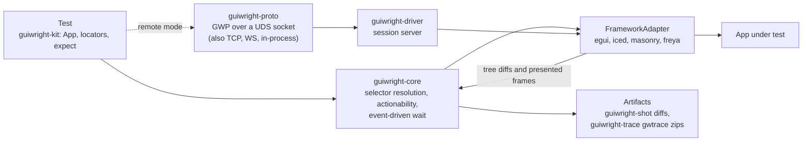

<div align="center">
  
  <p>
    <strong>Playwright-grade GUI testing for Rust frameworks, driven through the AccessKit accessibility tree.</strong><br/>
    Locators resolve against each framework's accessibility tree, actions run through its real
    input pipeline, and every step auto-waits on tree diffs and frame boundaries instead of
    sleeping. Adapters for egui, Masonry/Xilem, iced and Freya run in-process for tests, and the
    same adapter contract is served over a Unix domain socket, TCP or WebSocket for
    out-of-process sessions. The
    framework-agnostic core depends only on AccessKit (`accesskit` +
    `accesskit_consumer`), `thiserror` and `tracing`, and the whole workspace forbids unsafe code.
  </p>
  <p>
    <a href="https://github.com/elcoosp/guiwright/actions/workflows/ci.yml"></a>
    <a href="https://github.com/elcoosp/guiwright/blob/main/.github/workflows/ci.yml"></a>
    <a href="https://github.com/elcoosp/guiwright/blob/main/Cargo.toml"></a>
    <a href="https://github.com/elcoosp/guiwright/blob/main/Cargo.toml"></a>
    <a href="LICENSE-MIT"></a>
    <a href="https://github.com/elcoosp/guiwright/blob/main/Cargo.toml"></a>
  </p>
</div>

<p align="center">
  <a href="#quickstart">Quickstart</a> • <a href="#features">Features</a> • <a href="#how-it-works">How it works</a> • <a href="#usage">Usage</a> • <a href="#status">Status</a> • <a href="#learn-more">Learn more</a>
</p>

## Quickstart

Requires Rust 1.85 or newer (edition 2024). Tests run headless in your process; no display server or window is needed.

Add the kit to your dev dependencies:

```toml
[dev-dependencies]
guiwright-kit = { git = "https://github.com/elcoosp/guiwright" }
accesskit = "0.25"
```

Write a test. The `#[guiwright_kit::test]` macro launches the built-in fixture app (a "Save" button, a "Welcome, Ada" label and an "Email" text input), so this runs as-is:

```rust
use accesskit::Role;
use guiwright_kit::{App, expect};

#[guiwright_kit::test]
fn login_flow(app: &mut App) -> Result<(), String> {
    // Auto-waits for actionability, then clicks through the adapter.
    app.get_by_role(Role::Button, "Save")
        .click()
        .map_err(|e| e.to_string())?;

    // Retries until the condition holds or the 5 s default timeout expires.
    expect(app.get_by_text("Welcome, Ada"))
        .to_be_visible()
        .map_err(|e| e.to_string())?;
    Ok(())
}
```

Run it like any other Rust test:

```bash
cargo test
```

Swap in a real framework adapter with `App::launch(name, adapter)` as shown in [Usage](#usage).

> [!TIP]
> Set `GW_TRACE=1` to record a `gwtrace/v1` zip archive (tree snapshots, input events, logs, frame captures) per test, and `GUIWRIGHT_BLESS=1` to accept failing screenshot baselines.

## Features

- **Playwright-shaped locators.** `get_by_role`, `get_by_label`, `get_by_text`, `get_by_test_id` and `get_by_value`, with `.first()` / `.nth()` / `.last()` / `.has_text(...)` filters and strict-mode failure on ambiguous matches (`crates/guiwright-core/src/selector.rs`).
- **Actionability auto-wait without polling.** Clicks and fills wait for attached / visible / stable / enabled / receives-events checks that are woken by tree diffs and presented frames; a waiter fed no events does no work (`crates/guiwright-core/src/actionability.rs`, `crates/guiwright-core/src/wait.rs`, pinned by `crates/guiwright-core/tests/auto_wait.rs`).
- **Retry-until-timeout assertions.** `expect(locator).to_be_visible()`, `to_have_text`, `to_have_value`, the checked-state family (`to_be_checked` / `to_be_unchecked` / `to_be_checked_mixed` over AccessKit's tri-state) and friends complete exactly when the condition turns true, or fail with the locator, the check vocabulary and the last tree summary embedded in the error (`crates/guiwright-core/src/expect.rs`).
- **Count assertions and reads (the strict-mode escape hatch).** `expect(locator).to_have_count(n)` completes when the match set reaches `n` — in either direction (nodes streaming in and out), strict mode never consulted — and `locator.count()` reads the size of the whole match set right now; both window-scoped through a pinned handle, the timeout error naming the expected count, the locator and the count the last evaluation found (`crates/guiwright-core/src/wait.rs`, `crates/guiwright-kit/src/app.rs`).
- **Count comparators.** `to_have_count_greater_than(min)` / `to_have_count_less_than(max)` — the one-sided widening of the count surface on the same waiter (`CountMatch`): satisfied while the set stands on the demanded side of the bound, waitable in both directions, the timeout error naming the comparator (`count > 99 — …`) and the count the last evaluation found, composing with the negation modifier (`crates/guiwright-core/src/wait.rs`).
- **Match enumeration.** `locator.all(|item| …)` — Playwright's `Locator.all()` on the borrow-and-act surface: the locator's current match set in document order, each match handed to the visitor as an nth-pinned locator (a `Vec<Locator>` cannot exist while every locator holds the `&mut App`, so the matches arrive one at a time), the generic return collecting per-item data, the set a snapshot read like `count()`, window pins scoping it, and visited actions recording like hand-written `.nth(i)` actions (`crates/guiwright-kit/src/app.rs`).
- **Negated assertions (the `not` modifier).** `expect(locator).not().to_be_visible()` — the first waiter *decorator*: every existing `to_*` inverts through `NotWaiter`, satisfied exactly while the positive condition does not hold (absent, hidden, disabled, a count that differs), completing event-driven when the world changes; strict-mode violations and fail-fast checks keep failing, and the timeout header names the inversion *and* what still holds (`not (visible — …) (still visible)`) through the `Waiter::held_on` satisfied-state accessor (`crates/guiwright-core/src/wait.rs`, `crates/guiwright-kit/src/app.rs`).
- **Screenshot baselines with a perceptual diff.** Weighted squared YIQ pixel distance, an absolute `max_failed_pixels` budget, per-OS baseline directories and a `GUIWRIGHT_BLESS` flow that leaves `.new.png` and `.diff.png` artifacts next to a failing baseline — window-level via `app.screenshot` and element-level via `locator.screenshot(name, bless)` (resolve → render once → crop by the resolved bounds, §10) (`crates/guiwright-shot`, `crates/guiwright-kit`).
- **Time-travel traces.** Opt-in `gwtrace/v1` zip archives with postcard+LZ4 tree snapshots, hash-deduped frame captures and a `tracing`-fed event log, recorded through a bounded lock-free ring to a writer thread (`crates/guiwright-trace`).
- **Embedded and remote through one trait.** Tests call the `FrameworkAdapter` directly in-process; the same contract is served over the GWP wire protocol (length-prefixed postcard framing, LZ4 blob side channel) on a Unix domain socket, over TCP for CI containers, over WebSocket (M15) for the viewer live-mode shape, and over the in-process embedded door (M16) for hosts that want the whole remote stack with no socket at all (`crates/guiwright-driver`, `crates/guiwright-proto`).
- **Multi-window on the embedded surface.** `app.windows()` enumerates the adapter's window targets and `app.window(handle)` aims a borrow-and-act handle at one target — locators, assertions, waits and pre-pinned input born from it resolve only inside that window's subtree (the same scoping the wire's `Window::Use` gives a remote connection), codegen records the `app.window("…").get_by_role(…).click();` shape, and the Rust clients gain the same vocabulary as typed `ClientConn::window_list()` / `window_use()` methods (`crates/guiwright-kit/src/window.rs`, `crates/guiwright-proto/src/client.rs`).
- **Live REPL over the wire.** `guiwright repl` attaches to a running remote-mode app — locators, actions, the virtual clock, state seams, codegen recording and video, all as commands mapped 1:1 onto GWP requests (`crates/guiwright-cli`, architecture §13/§16).
- **Inspector overlay + highlight.** `app.inspect().highlight(&locator)` (and `inspect <get-args…>` in the REPL, `inspectHighlight` in the TypeScript client) composites hover outlines + interactive-role badges onto the app's scene at present time — the §13 live overlay session, adapter-level by design (`crates/guiwright-inspect`, `crates/guiwright-kit`).
- **Screenshots over the wire.** `Screenshot { Window | Element }` over GWP returns PNG evidence from a remote session — window frames rendered once, element crops cut from that frame by the resolved bounds (§10 "never re-render"), `screenshot [path]` in the REPL and `screenshotWindow()` / `screenshotElement()` in the TypeScript client (`crates/guiwright-driver`, `crates/guiwright-proto`).
- **Full-tree dumps.** `snapshot full` in the REPL and `treeDump()` in the TypeScript client read the whole logical tree as typed rows (role, name, value, bounds, children) depth-first per window — the §7 tree domain's full form, the M0 summary's recorded completion (`crates/guiwright-driver`, `crates/guiwright-proto`).
- **Live event stream over the wire.** `subscribe(kinds)` / `nextEvent()` (TypeScript) or `Client::subscribe` / `next_event` (Rust) turns a connection into a §7 subscriber: tree diffs and presented frames arrive as `Event` frames between responses while the app advances — no polling, the seq numbers expose any gap a slow consumer misses, and `events on | off` in the REPL flushes them between commands. The session's opt-in log tail (`ServerOptions::log_tail`) streams the session thread's `tracing` records as `EventKindV1::Log` — one `logs.ndjson`-shape JSON line per record (`crates/guiwright-driver/src/events.rs`, `crates/guiwright-driver/src/log_tail.rs`, `crates/guiwright-proto/src/conn.rs`).
- **Filtered tree dumps.** `snapshot under <get-args…>` in the REPL and `treeDumpUnder(selector, timeoutMs?)` in the TypeScript client resolve a locator (auto-wait, window scope) and dump only that subtree as typed rows — the §7 tree domain's scoped form (`crates/guiwright-driver/src/session.rs`).
- **Trace viewer + CLI plumbing.** `guiwright show-trace` renders a `gwtrace/v1` zip into a self-contained scrubber HTML, the viewer's live mode (M18) attaches to a *running* session over any GWP door (`ClientConn` + `LiveFeed`/`LiveTimeline` — the same scrubber model, fed live) and emits the same scrubber HTML mid-session from the accumulated model (`render_live_html`, M23 — stamped `gwtrace/v1 (live)`), `guiwright bless` promotes CI screenshot artifacts onto their baselines, `guiwright install-deps` prints the §11 CI provisioning commands (`crates/guiwright-viewer`, `crates/guiwright-cli`).
- **Performance budgets enforced in CI.** Criterion benches plus a `check_budgets` binary that fails the build when p95 samples regress against `bench/budgets.toml` (`crates/guiwright-bench`, `.github/workflows/ci.yml`).

## How it works

Every framework implements one `FrameworkAdapter` trait whose methods execute on the UI thread at frame boundaries. Frameworks that already emit an AccessKit tree (egui, Masonry, Freya) hand their `TreeUpdate`s to the adapter, which folds them into an incremental consumer tree; for iced, which has no accessibility tree, the adapter builds one from widget reports plus a role registry contributed by the app. Selectors resolve against that tree, semantic actions rendezvous with the next frame, and waiters are woken by diffs and frame-presented events rather than by polling. In remote mode, the driver exposes the same adapter contract as a session server speaking GWP over a Unix domain socket (default), TCP, or WebSocket (M15), so out-of-process clients get identical semantics.



## Usage

The examples below are condensed from the workspace's own integration tests.

### Click and assert against a real app (egui)

```rust
use std::{cell::RefCell, rc::Rc, time::{Duration, Instant}};

use accesskit::Role;
use guiwright_adapter_egui::EguiAdapter;
use guiwright_core::Selector;
use guiwright_driver::Session;

let state = Rc::new(RefCell::new(CounterApp::default()));
let ui_state = Rc::clone(&state);
let adapter = EguiAdapter::new(move |ctx: &egui::Context| {
    ui_state.borrow_mut().ui(ctx); // your normal egui painting code
});

let mut session = Session::new(adapter);
session.settle(Instant::now() + Duration::from_secs(2));
session.click(&Selector::role_named(Role::Button, "Save"))?;
assert_eq!(state.borrow().clicks, 1);
```

The adapter drives a real `egui::Context` windowless: AccessKit tree generation, synthetic input and a virtual clock all run through the standard `Session` loop, so embedded and remote sessions behave identically (see `crates/guiwright-adapter-egui/tests/egui_embedded.rs`).

### Screenshots and baselines

```rust
use guiwright_kit::{App, BlessMode};

let mut app = App::launch("shot_test", my_adapter)
    .with_baseline_dir("tests/screenshots");

app.screenshot("main", BlessMode::Failing)?; // first run: writes the baseline
app.screenshot("main", BlessMode::Off)?;     // later runs: Matched or Mismatch
```

A mismatch fails the test and writes `<name>.new.png` plus a rendered `<name>.diff.png` next to the baseline. Baselines are stored per platform, scale factor and renderer; tolerances come from `Guiwright.toml` with per-OS overrides. A virtual clock (`app.clock_fast_forward(Duration::from_secs(30))`) makes time-dependent UI deterministic.

### Remote session over a Unix domain socket

```rust
use guiwright_driver::{MockAdapter, spawn_session_server};
use guiwright_proto::{Client, RequestV1, ResponseV1};

// App side (or a test host): serve GWP on a UDS socket. Real apps serve
// their own adapter; MockAdapter comes from guiwright-driver's `mock` feature.
let handle = spawn_session_server(socket_path, || MockAdapter::with_fixture(&fixture))?;

// Client side: handshake, then Playwright-shaped commands over the wire.
let mut client = Client::connect(&socket_path).await?;
let caps = client.handshake("guiwright-tests/0.1").await?;
match client.request(RequestV1::TreeSnapshot).await? {
    ResponseV1::TreeSnapshot { node_count, .. } => println!("{node_count} nodes"),
    other => panic!("unexpected response: {other:?}"),
}
```

Resolve requests carry selectors and auto-wait over the wire the same way embedded sessions do (see `crates/guiwright-driver/tests/remote_session.rs`).

### Live REPL against a running app (M4)

```bash
# App side: serve its adapter in remote mode (§5.3).
GUIWRIGHT_DRIVER=uds:///tmp/app.gwp ./my-app &

# Your side: attach and debug interactively.
guiwright repl --uds /tmp/app.gwp
```

```text
gw> snapshot
tree @3: 12 nodes
gw> get role Button Save
resolved Button "Save" (generation 0) rect=[16,16 → 136,48]
gw> click
Button "Save": clicked (frame 7)
gw> clock install
clock: virtual=0ms paused=false steps=0
gw> codegen start
…act, then…
gw> codegen stop
codegen: 1 line(s), 0 warning(s)
app.get_by_role(Role::Button, "Save").click();
```

Every command maps onto a GWP request — the same conversation works over TCP (`guiwright repl --tcp 127.0.0.1:41234`) and from the TypeScript client (`clients/typescript`). `guiwright show-trace <archive.zip>` renders a recorded trace into a self-contained HTML scrubber, `guiwright bless <dir>` promotes CI screenshot artifacts onto their baselines, and `guiwright install-deps` prints the §11 CI provisioning commands (see `crates/guiwright-cli/tests/`).

### `guiwright test` — scenario specs in CI (M5)

The REPL session pastes into a spec verbatim: a `gwtest/v1` file declares scenarios whose steps are REPL-command strings, and the runner drives them over GWP with workers, retries, sharding and reports.

```toml
# tests/guiwright/login.spec.toml
target = "uds:///tmp/app.gwp"   # or override with --uds / --tcp

[[scenario]]
name = "save the document"
steps = [
  "get role button Save",
  "click",
  "expect role label \"Welcome, Ada\"",
]
```

```bash
# Local: run everything against a live app.
guiwright test --uds /tmp/app.gwp

# CI: one app per shard, retries for flaky scenarios, JUnit + HTML reports
guiwright test --tcp 127.0.0.1:41234 --shard 1/3 --retries 2 \
    --report junit --report html --out guiwright-report
```

Every step maps onto an existing GWP request — no protocol change. A step's error line fails the scenario; `expect <get-args…>` words failures as assertions. Failed scenarios re-run per `retries` (spec, scenario or `--retries`), passing on a retry reports `flaky`. `--list` prints the discovered scenarios (shard-aware) without touching the wire, and reports land as `report.json` (`gwrun/v1`), `junit.xml` (one suite per spec file) and a self-contained `report.html` (see `docs/m5-test-runner.md` and `crates/guiwright-cli/tests/runner_e2e.rs`).

### Multi-window: targets per window (M6)

A multi-window app exposes one target per window; each connection aims at its own target and locators see only that window's subtree — one driver session serves every connection (§11).

```bash
guiwright repl --uds /tmp/app.gwp
```

```text
gw> window list
window targets (2):
  a6000000-0000-0000-0000-000000000001 Editor focused
  a6000000-0000-0000-0000-000000000002 Preview
gw> window use a6000000-0000-0000-0000-000000000001
now targeting a6000000-0000-0000-0000-000000000001 (Editor)
gw> get role button Save          # strict mode inside the editor window only
resolved Button "Save" (generation 0) rect=[16,16 → 136,48]
```

`window use` works verbatim inside `gwtest/v1` spec steps (the runner drives the same REPL core), the TypeScript client carries `windowList()` / `windowUse(handle)`, and the embedded kit surface mirrors both: `app.window(handle).get_by_role(…)` resolves inside the aimed window (`crates/guiwright-kit/examples/multi_window.rs`). On the wire the `Window` domain appends after `Video` (discriminant 11 — the same append-only discipline as the M3 video domain; every pre-M6 client keeps its byte-exact encodings). Single-window adapters report exactly one `main` target and need no changes; window handles are the AccessKit subtree `TreeId`s the adapter already pushes (see `docs/m6-multi-window.md` and `crates/guiwright-driver/tests/multi_window.rs`).

### Supported adapters

| Framework | Crate | Accessibility source | CI coverage |
|---|---|---|---|
| egui | `guiwright-adapter-egui` | egui's own AccessKit tree (Level 1) | embedded tests on Linux, macOS, Windows |
| Masonry / Xilem | `guiwright-adapter-masonry` | `RenderRoot` via `masonry_testing::TestHarness` (Level 1) | embedded tests on Linux, macOS, Windows |
| iced | `guiwright-adapter-iced` | Guiwright-built logical tree + app-contributed role registry (Level 2); harness glue behind the `iced` feature | compile-verified in CI |
| Freya | `guiwright-adapter-freya` | `freya_testing` harness + `a11y_id` bridge (Level 1); runner glue behind the `freya` feature | compile-verified in CI |
| Slint / Floem / GPUI | `guiwright-adapter-slint` / `-floem` / `-gpui` | framework-free adapter engines (Level 1/2 hybrids — see each crate's docs); platform glue ships downstream against recorded constraints | engine tests in the normal CI matrix |

"Level" is the integration tier from [docs/architecture.md](docs/architecture.md): Level 1 piggybacks on a framework's existing accessibility tree, Level 2 synthesizes one.

## Status

> [!NOTE]
> Guiwright is a pre-release project at version 0.4.0, with milestones M0–M2 of the plan in [docs/architecture.md](docs/architecture.md) implemented across the workspace crates, M3 shipped as framework-free adapter engines (floem, gpui), the video recorder and the TypeScript client, M4 — the `guiwright-cli` crate (`repl`, `show-trace`, `bless`, `install-deps`) plus remote codegen recording (§13) — M5 — the §16 v0.5 own runner: `guiwright test` discovers `gwtest/v1` scenario specs (REPL-language steps) and drives them over GWP with workers, retries with flaky detection, deterministic `--shard k/n` splitting and `gwrun/v1` JSON / JUnit / HTML reports — M6 — the §16 v0.4 multi-window row: the append-only `Window` domain over GWP (`window list` / `window use <handle>` in the REPL and in spec steps, `windowList()` / `windowUse()` in the TypeScript client), per-connection window targets over one shared driver session, and window-scoped resolution built on AccessKit's grafted-subtree window model (single-window adapters report one `main` target and compile unchanged) — with the embedded half (`app.windows()` / `app.window(handle)` / scoped locators + assertions in `guiwright-kit`) and the Rust-client parity (`ClientConn::window_list()` / `window_use()`) closing the surfaces M6 left to the REPL and the TypeScript client — M7 — the §9 input pipeline over the wire: the `Gesture` domain appended to the V1 envelope (click / drag / wheel / key / type, synthesized driver-side from the adapter's pacing table), the M0-era `Input` domain un-blocked with per-window routing (the connection's active target steers window-relative coordinates), `mouse` / `key` / `text` commands in the REPL (and verbatim in spec steps), and the Playwright-shaped `mouse` / `keyboard` surface in the TypeScript client, byte-pinned by new golden vectors and covered by the cross-language e2e — and M8 — the §13 interactive overlay session: the append-only `Inspect` overlay/highlight half (`EnableOverlay` / `DisableOverlay` / `Highlight`) over GWP, the `FrameworkAdapter::show_overlay` seam (egui composites the plan inside its pass; masonry converts it to layer draw ops), the kit's `app.inspect()` surface, the REPL's `inspect on | off | clear | <get-args…>` command and `inspectOverlay()` / `inspectHighlight()` in the TypeScript client, byte-pinned by new golden vectors, with the adapter-error structure preserved end-to-end (`AdapterError::Unsupported` reaches the wire as `ErrorCode::Unsupported`; the paused-clock rejection is a typed error, not a string match) — M9 — element screenshots on the locator surface: `locator.screenshot(name, bless)` resolves the node (auto-wait), renders the window frame once, crops it by the resolved physical bounds (the §10 "never re-render" rule, consuming the M1-bound `guiwright-shot::crop` hot path) and asserts against the same per-platform baselines, tolerances and bless artifacts as the window-level flow, with a `locator_element_screenshot` budget row enforcing the end-to-end cost — M10 — the §7 render domain: `Screenshot { Window | Element { selector, timeout_ms } }` → `Shot` over GWP returns PNG evidence from remote sessions (one render pass, element crops cut data-side from that frame, capability rows honored — `Unsupported` without a pixel path), with `screenshot [path]` in the REPL, `screenshotWindow()` / `screenshotElement()` in the TypeScript client, byte-pinned goldens and a `wire_screenshot_window` budget row — and M11 — the tree-dump domain: `Snapshot::Full` → `TreeDump` returns the whole logical tree as typed rows (key/role/name/value/bounds/children) depth-first per window root — the M0-era `TreeSnapshot` promise cashed — with `snapshot full` in the REPL, `treeDump()` in the TypeScript client, byte-pinned goldens and a `tree_dump_walk` budget row — and M12 — the §7 event channel: the append-only `Subscribe` domain (`On { kinds } | Off`) turns a connection into a subscriber, pushed `Event` frames ride the response envelope between responses (a connection that never subscribes keeps its byte-exact conversation; `Log` is an honest `Unsupported` until the log-tail milestone), the driver's session thread pumps at frame cadence while anyone is subscribed, the Rust clients gain `subscribe`/`next_event`, the TypeScript client `subscribe()`/`nextEvent()`, the REPL `events on | off`, byte-pinned goldens and a `wire_event_delivery` budget row — and M13 — filtered tree dumps: `Snapshot::Filtered { selector, timeout_ms }` resolves (auto-wait, window scope) and dumps only the match's subtree, with `snapshot under <get-args…>` in the REPL, `treeDumpUnder()` in the TypeScript client, byte-pinned goldens and a `tree_dump_filtered` budget row — and M14 — the event channel's log half: `EventKindV1::Log` served from the per-session `tracing` tap (`ServerOptions::log_tail`, a thread-local dispatcher on the session thread whose records stream as one `logs.ndjson`-shape JSON line per `EventV1::Log` frame, a bounded live tap that never replays, a session without the tail still answering the honest typed `Unsupported`), the REPL's `events on` carrying the kind, `log_tail_batch` budget row, a `wire_logs` example and the schema doc rows re-pinned — and M15 — §7's third transport served in Rust: the WebSocket door (`guiwright_proto::ws`, an RFC 6455 server + client with zero new dependencies), `GwpServerHandle::spawn_ws` / `spawn_ws_with` on the same session stack, `--ws ws://host:port` on the REPL (and spec targets), a `wire_ws` example, the `ws_ping_roundtrip` budget row and the cross-language e2e leg where the TypeScript client's `connectWs` (M3) finally meets its server, byte-pinned by a shared connection state machine that all three transports delegate to — and M16 — §7's fourth door, the embedded transport: `guiwright_proto::duplex` (in-process `tokio::io::duplex` pipes, no socket, no filesystem) served by `GwpServerHandle::spawn_inprocess` on the same session stack, with the door's bring-up seam published as `Transport` + `spawn_transport_with` so a downstream TLS listener or named-pipe bridge plugs in without a byte of protocol change, a `wire_inprocess` example and the `inprocess_ping_roundtrip` budget row — and M17 — the wire `Action` request honors `force` and `timeout_ms`: the pre-resolved actionability gate (`Session::apply_action`'s retired `let _ = (force, timeout_ms)` debt) re-checks the pinned node at act time with `wait_for`'s zero-polling cadence and the published `StabilityTracker`, refuses with a `Timeout` that names the stuck check (`stuck on visible (node has no bounds yet)`), skips exactly the stability + hit-test checks under `force`, and rides the `wire_action_click` budget row — and M18 — the §12 viewer's live mode: the client-side `ClientConn` seam (the mirror of `Handler`, implemented by the UDS/TCP/WS/embedded clients, one seam per conversation half), the viewer's `LiveFeed`/`LiveTimeline` attaching to a running session over any door — subscribe to the M12 event vocabulary, dump-per-change via `Snapshot::Full` with parent links rebuilt from the children-count contract, the same scrubber model the archive path builds through `Timeline::from_parts` — a `live_tree` consumer example and the `viewer_live_sync` budget row — and M19 — the kit locator action parity: `locator.press/check/uncheck/set_checked/focus/blur` over the same actionability-gated, codegen-recorded path as `click`/`fill`/`hover` (the wire's semantic vocabulary finally on the DSL surface, no new session or wire code) — and M20 — the checked-state assertions: the AccessKit tri-state (`Toggled::True/False/Mixed`) surfaced as the §8 check row `Check::Checked`, the `expect(locator).to_be_checked()` / `to_be_unchecked()` / `to_be_checked_mixed()` family over the same event-driven wait as every other `to_*` assertion (waitable states, fail-fast for roles that never expose one, timeout errors naming the assertion and the locator) with the `checked_assert` budget row — and M21 — the locator wait-for surface: Playwright's `locator.waitFor(state)` as `locator.wait_for(state)` (`attached`/`visible`/`hidden`/`stable`, each mapping 1:1 onto the §8.3 check table), the same zero-polling session loop underneath, codegen-recorded (`locator.wait_for();`) and timeout errors naming the state and the locator (no new session or wire code) — and M22 — the count surface: Playwright's `toHaveCount` / `count()` escape hatch from strict mode as `expect(locator).to_have_count(n)` (the first selector-level waiter — the match-set size, strict mode never consulted, waitable in both directions, the `Waiter::stuck_on` seam carrying `count 99 — getByRole(Button) (found 4)` into the timeout header) and `locator.count()` as the sync read, over the same zero-polling loop and window scoping, no new session or wire code — and M23 — the §12 live-capture HTML emitter: `render_live_html` / `LiveFeed::render_html()` emit the same self-contained scrubber the archive path renders, mid-session from the accumulated live model (one shared payload builder, the attach report's adapter name in the header, an honest `gwtrace/v1 (live)` schema stamp) — and M24 — the negated assertion surface: `expect(locator).not().to_*` (Playwright's `not` modifier) as the first waiter *decorator* — `NotWaiter` wraps any `Box<dyn Waiter>` and inverts the waitable outcome (positive satisfied → negation pends, positive pending → negation holds, fail-fast and strict mode still failing), the whole existing `to_*` vocabulary negated at once including the window-scoped surface and the count seam, the timeout header naming the inversion (`not (visible — …)`), a `not_assert` budget row, no new session or wire code — and M25 — the count comparators: `to_have_count_greater_than(min)` / `to_have_count_less_than(max)` as the m22 record's reserved widening on the same waiter (`CountMatch` as data: `holds`/`describe`/`bound`, the exact header byte-identical through the shared path), waitable in both directions, composing with the M24 decorator, a `count_compare` budget row, no new session or wire code — and M26 — the locator `all()` enumeration: the m22/m25 records' open kit gap (`locator.all(visit)`, Playwright's `Locator.all()` on the borrow-and-act surface — the match set in document order, each match handed to the visitor as an nth-pinned locator because a `Vec<Locator>` cannot exist while every locator holds the `&mut App`, the generic return collecting per-item data, the set a snapshot read like `count()`, the window pin scoping it, visited actions recording like hand-written `.nth(i)` actions) over the same `resolve_all` seam, no new session or wire code — and M27 — the waiter satisfied-state accessor: the m24 record's reserved `Waiter::held_on` seam (`ChecksWaiter` naming the checks that pass, `CountWaiter` the count that holds, `NotWaiter` delegating to the inner form), the negated timeout header now embedding what still holds (`not (visible — …) (still visible)`) through the core `check_now` and driver `wait_with` paths, no new waiter or wire code. CI exercises the full test suite on Linux, macOS and Windows (Linux uses software Vulkan via lavapipe for render-dependent tests), runs the TypeScript client suite and the cross-language e2e, compile-verifies the feature-gated iced and freya harness glue, and enforces the perf budgets. The floem and gpui platform glue ships downstream (recorded constraints in the crate docs and `docs/m3-floem-contributions.md`). Crates are packaged by the release workflow into GitHub releases; crates.io publication is not yet automated. The MSRV is 1.85 and the workspace forbids unsafe code.

## Learn more

- [docs/architecture.md](docs/architecture.md) — the full design: per-framework integration dossiers, process model, the GWP protocol spec, the Playwright parity map and performance engineering. Milestone records live alongside: `docs/m2-gpui-remote-spike.md` … `docs/m27-waiter-held-on.md`.
- [CHANGELOG.md](CHANGELOG.md) — generated from Conventional Commits by git-cliff (`cliff.toml`); tagging `vX.Y.Z` triggers the release workflow.
- [bench/budgets.toml](bench/budgets.toml) — the p50/p95 budget table enforced by the CI guard.
